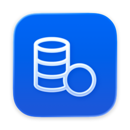

# Kontor: Eine Buchhaltungs-App, bei der ich nicht getippt habe

*Den Swift-Code hat Claude geschrieben. Was die App rechnet, was sie weglässt und wann sie stehen bleibt, habe ich entschieden. In unter drei Wochen wurde daraus eine echte macOS-App.*

*Die Übersicht, gefüllt mit Demodaten einer erfundenen Designerin aus Berlin.*

Ich bin UI Designer, kein Swift-Entwickler. Den Quelltext von Kontor, meiner lokalen Buchhaltungs-App für macOS, hat Claude im Terminal getippt, Schritt für Schritt. Meine Rolle war die eines Product Owners: Ich habe spezifiziert, entschieden, geprüft und am Ende verantwortet, was die App ausrechnet. Vom ersten Commit am 28. Juni bis zu diesem Beitrag waren es 127 Commits, abgesichert von 226 Tests.

## Warum ein drittes Werkzeug

Jahrelang lief meine Buchhaltung in Obsidian, mit Rechenblöcken in `math.js`. Das war charmant und ganz meins, bis Quartalsabschluss, Soll-Versteuerung, Reverse-Charge, Künstlersozialkasse und Forderungsausfälle daraus ein Gebilde machten, bei dem ich vor jeder Änderung die Luft anhielt.

Für Zeiten und Rechnungen nutze ich zwei Apps von Timo Partl, WorkingHours und SubTotal. Was fehlte, war der Ort, an dem zum Monats-, Quartals- und Jahresabschluss alles zusammenläuft. Das wurde Kontor, als Ergänzung zu den beiden, nicht als Ersatz. Die ersten Versionen hatten sogar eigene Importer für meine alten Daten aus Obsidian und SubTotal. Nach der Übernahme flogen sie wieder raus.

## Eine Rechnung, zwei Kalender

Das Wichtigste an der App sieht man von außen nicht: Dieselbe Rechnung lebt in zwei Kalendern. Die Umsatzsteuer zählt bei mir nach Soll, also wenn ich die Rechnung schreibe. Der Gewinn zählt nach Zufluss, also wenn das Geld ankommt. Im Dezember geschrieben, im Januar bezahlt: Die Umsatzsteuer gehört ins vierte Quartal, der Gewinn ins Folgejahr. Wer das nicht sauber trennt, rechnet falsch und merkt es vielleicht nie.

Die Umsatzsteuer-Voranmeldung füllt Kontor nach den echten ELSTER-Kennzahlen aus (KZ 81 und 86 für die Bemessung, KZ 66 für die Vorsteuer, KZ 83 für die Zahllast) und rundet auf den Cent wie ELSTER selbst. Zwei Sonderfälle mussten dabei genau stimmen:

- **Reverse-Charge nach §13b:** Für ein US-Werkzeug wie Figma schulde ich die Umsatzsteuer selbst und ziehe sie im selben Zug als Vorsteuer wieder ab. Unterm Strich null, der Nettobetrag bleibt aber eine Betriebsausgabe.
- **Forderungsausfall nach §17:** Zahlt ein Kunde nie, bekomme ich die Umsatzsteuer zurück. Das Formular hat dafür kein eigenes Feld, also mindert die Korrektur die Bemessungsgrundlage, statt als eigene Zeile aufzutauchen.

Die Regeln selbst habe ich nicht erfunden, sie kommen aus meinem Alltag als KSK-versicherter Freiberufler und standen vorab in einer ausführlichen Spezifikation. Neu war ihre Übersetzung in eine Rechenlogik, die stur getestet wird. Getestet wird gegen eine erfundene Demo-Persona, damit keine echten Finanzdaten im offenen Quellcode landen. Ein eigener Wächter schlägt an, falls doch einmal etwas Persönliches hineinrutscht.

## Der Kontoauszug, der dazulernt

Die naheliegende Idee war: Kontoauszug rein, die KI ordnet alles zu. Wir haben das gebaut und wieder verworfen. Das Raten nach Beträgen machte aus 14 Euro in der Apotheke schon mal zuversichtlich ein neues Handy.

Jetzt rät Kontor nichts mehr vollautomatisch. Ich ordne jede Bankbewegung selbst zu, und die App merkt sich das pro Händler. Habe ich Figma einmal als Reverse-Charge-Ausgabe gebucht, schlägt sie es beim nächsten Mal vor. Nur aktives Buchen lehrt, wer überspringt, bringt der App nichts bei. Ein kleiner Satz Startregeln für verbreitete Werkzeuge ist dabei, und wer denselben Auszug zweimal lädt, bekommt keine Dubletten. Das automatische Zuordnen habe ich bewusst nicht wieder eingebaut.

## Was schwierig war

Die gefährlichen Fehler sahen selten gefährlich aus. Meistens sahen sie richtig aus.

**Typografische Anführungszeichen.** Wo im Swift-Code gerade Anführungszeichen stehen müssen, landeten manchmal die geschwungenen, und der Build brach mit einer kryptischen Meldung ab. Im Diff sehen beide fast gleich aus. Die Lösung war kein Code, sondern ein kleines Skript, das vor jedem Commit nach diesem einen Zeichen sucht.

**Die Belegerkennung.** Den Text liest Apples Erkennung direkt auf dem Gerät, ohne Upload. Aus verstreuten Wortfetzen wieder „das ist der Nettobetrag“ zu machen, war Handarbeit: Beträge den richtigen Beschriftungen zuordnen, englische Datumsformate wie „June 4, 2025“, deutsche Tausenderpunkte. Dazu kam ein sporadischer Absturz. Die PDF-Seiten wurden über einen Zeichenweg gerendert, der nur auf dem Haupt-Thread erlaubt ist, und die Stapelverarbeitung renderte mehrere Belege gleichzeitig im Hintergrund. Seitdem rendert jeder Vorgang für sich, und ein Test fährt bewusst acht Renderings parallel.

**Die plausible falsche Zahl.** Meine Kernzahl „Frei verfügbar“ wurde an drei Stellen unabhängig berechnet. Die falsche Variante nutzte ausgerechnet der lokale KI-Server: Er meldete 2.233 Euro, der Monatsabschluss 1.043 Euro. Die Differenz von 1.190 Euro war genau eine Betriebsausgabe, die die falsche Formel vergessen hatte. Der Commit dazu heißt „Gewinn-Waterfall hat eine Quelle“. Dazu kamen ein Import, der aus englischem „1332.80“ still 133.280 machte, und eine vierteljährliche Aufgabe, die sich beim Abhaken täglich neu anlegte. Fast jeder dieser Fehler hatte dieselbe Ursache: Dieselbe Wahrheit lebte an zwei Orten und lief auseinander.

**Die echte Datenbank.** In Kontor liegen meine echten Finanzdaten. Ein übereifriger Notfallpfad hätte die Datenbank schon bei einem harmlosen Fehler, etwa einer kurz gesperrten Datei, beiseitegeschoben und die App leer neu gestartet. Jetzt gibt es erst einen zweiten, ruhigen Versuch, und wenn wirklich alles scheitert, wird die alte Datenbank verschoben, nie gelöscht. Ob eine Notfallreparatur so weit gehen darf, ist keine Frage an den Code, sondern an den, der die Verantwortung trägt.

## Veröffentlichen

Kontor ist kostenlos und quelloffen. Das hat einen sehr deutschen Grund: Als KSK-Versicherter möchte ich meinen Status nicht gefährden, indem ich Software gewerblich verkaufe. Verschenken geht. Vertrieben wird über GitHub und Homebrew, bewusst ohne Notarisierung, mit dem bekannten Umweg beim ersten Start.

Der Mac App Store brauchte mehrere Anläufe. Die erste Einreichung wurde zweimal abgelehnt: einmal wegen des optionalen lokalen KI-Servers (Regel 2.4.5), einmal wegen meines freiwilligen Spendenlinks (In-App-Kauf-Pflicht, Regel 3.1.1). Am 14. Juli habe ich den Store-Vertrieb komplett entfernt, am 17. Juli kam eine schlanke Variante ohne KI-Server und Spende zurück, mit der alten Bundle-ID, damit vorhandene Daten weiterleben.

An einem Punkt habe ich außerdem die Git-Historie neu aufgesetzt, um Claude als Mitautor aus den Commits zu nehmen. Nicht aus Scham, sondern damit das Repository unter dem Namen dessen steht, der dafür geradesteht.

## Was ich mitnehme

Jede Zahl braucht genau eine Quelle. Klein und für einen einzigen Fall gebaut schlägt groß und für alle: Kontor kann keine Bilanzierung und keine Kleinunternehmerregelung, aber genau meine Steuersituation, und die richtig. Und die wichtigste Regel in der Zusammenarbeit mit Claude ist „frag nach“. Wo die Maschine bei Unsicherheit stehen blieb, wurde es gut. Wo sie plausibel weiterriet, wurde es teuer.

Claude hat Code geschrieben, den ich selbst nie geschrieben hätte. Die Verantwortung hat es mir nicht abgenommen. Es hätte mir drei leicht verschiedene Versionen derselben Zahl hingeschrieben und alle für richtig gehalten, bis ich das Gefühl hatte, dass da etwas nicht stimmt. Dieses Gefühl hat der Mensch, der die Zahl am Ende ans Finanzamt schickt.

*Kontor ersetzt keine Steuerberatung, die Zahlen gehören vor jeder Abgabe selbst geprüft. Danke an Timo Partl für WorkingHours und SubTotal.*

## Nachträge

### Abgelöst von wiredframe (20. Oktober)

Kontor ist veröffentlicht und bleibt es: als Quellcode und Release auf [GitHub](https://github.com/Wiredframe/kontor-buchhaltung) und per Homebrew. Im Mac App Store stand es von Juli bis Anfang Oktober, seitdem gibt es Updates nur noch über GitHub und Homebrew.

Im Alltag benutze ich Kontor seit Ende September nicht mehr. Am 26. September habe ich meine echten Daten aus WorkingHours, SubTotal und Kontor in [wiredframe](/blog/wiredframe/) übernommen, meine eigene Terminal-App, in der Zeiten, Rechnungen, Ausgaben, Kontoauszug und Steuern als verbundene Datensätze zusammenlaufen. Die Rechenlogik aus Kontor ist dabei in mehreren Schritten mitgewandert.

Ganz eingeschlafen ist Kontor trotzdem nicht. Am 19. Oktober kam Version 3.2.13 mit Steuerfristen, einer Seite für die Steuererklärung und einem Export für Mein ELSTER. Eine Zusage für die Zukunft gibt es aber nicht, das steht inzwischen auch so im README: Ich pflege Kontor nach Möglichkeit weiter, für meine eigene Buchhaltung ist es abgelöst.

