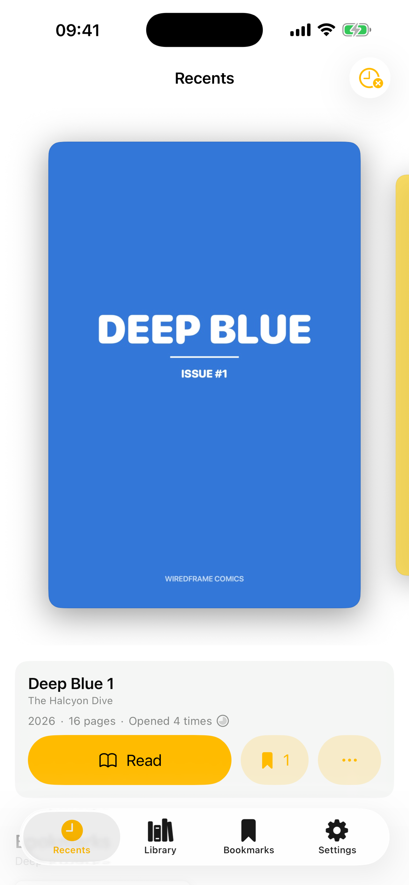
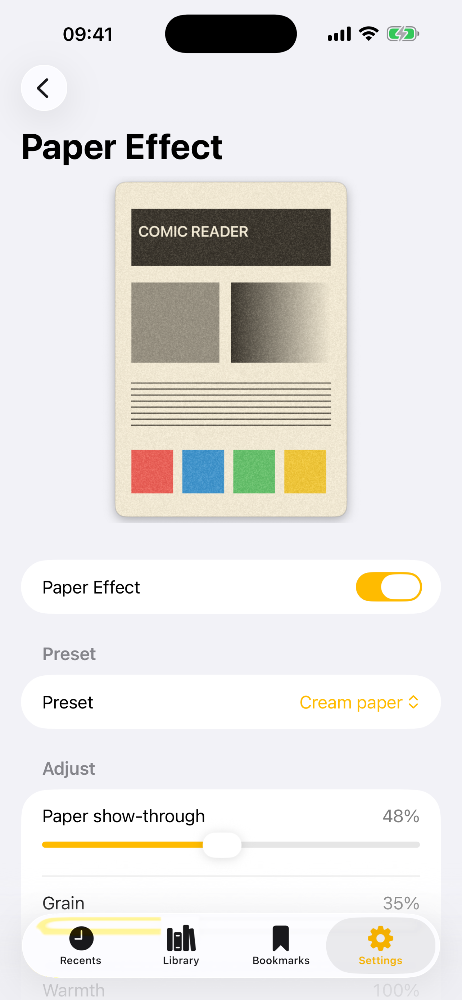

# Paper Comic Reader: Comics wie auf Papier gedruckt

*Ich bin UI Designer und schreibe keine Schleifen von Hand. Trotzdem liegt jetzt eine iOS-App von mir im App Store, gebaut zusammen mit Claude, angestoßen von einem Rest Wochenkontingent.*

*Zuletzt gelesen als Karussell. Die Cover sind mitgelieferte Demo-Comics, keine Verlagsware.*

Ich kann eine halbe Stunde über einen Schatten mit vier Punkt Unschärfe diskutieren. Eine saubere `for`-Schleife bekomme ich allein nicht hin. Paper Comic Reader gibt es trotzdem: ein schlanker, nativer Comic-Reader für iPhone und iPad, der Seiten so zeigt, als wären sie mit Tinte auf Papier gedruckt, statt hinter leuchtendem Glas.

Angefangen hat es auf dem Mac. Ich hatte [Simple Comic](https://github.com/Wiredframe/Simple-Comic), einen alten Open-Source-Reader, geforkt und ihm einen Metal-Shader für einen Papier-Look eingebaut. Als die erste Comicseite damit aussah wie frisch gedruckt, war die Frage naheliegend: Geht das auch auf dem iPhone?

Der Anlass war dann ganz unspektakulär. Abends sah ich, dass ich in Claude Code noch Tokens für die Woche übrig hatte, die am nächsten Tag um zwölf verfallen würden. Also habe ich angefangen. Kein Plan, keine Roadmap, nur die Idee. Die Arbeitsteilung blieb danach immer gleich: Ich habe geschaut, entschieden und verworfen, Claude hat den Code geschrieben, Geometrie durchgerechnet und mit der Toolchain gerungen.

## Papier aus Licht

Ein Bildschirm leuchtet, Papier nicht. Comics wurden auf warmes, leicht cremefarbenes Papier gedruckt, hinter Glas wirken sie zu sauber und zu blau. Der Effekt zieht deshalb reines Weiß Richtung Creme, hebt reines Schwarz zu einem warmen, tiefen Grau an und nimmt Sättigung und Kontrast etwas zurück. Aus Hochglanz wird matter Druck.

Dazu kommt das Korn, und zwar zweifach, so wie bei echtem Papier: eine feine Struktur auf den hellen Flächen und Fasern, die durch die Druckfarbe schimmern, am stärksten in den dunklen Partien. Gerade dieses Durchscheinen macht für mich den Reiz eines gedruckten Comics aus.

Die erste Fassung des Korns hatte ein feines Gitter, wie ein Fliegengitter. Das Rauschen lag brav am Pixelraster. Die Lösung war, jede Rauschebene ein Stück zu drehen, damit sich nichts mehr mit dem Raster deckt. Bewusst bemerkt das niemand. Dass es fehlt, bemerkt dagegen jeder.

*Die Einstellungen mit Vorschau. Die Regler gibt es auch als benannte Papiersorten.*

Weil ich in Materialien denke und nicht in Prozentwerten, gibt es Voreinstellungen: Cream Paper, Newsprint, Manga und E-Ink. Der Effekt läuft als kleines Programm auf der Grafikkarte, mit einem Ersatzweg, falls es einmal nicht lädt.

## Was nur beim Anfassen auffällt

Comics lesen heißt blättern und drehen. Am ersten Tag brauchte es sechs Anläufe für eine einzige Drehung, weil im Querformat die rechte Hälfte einer Doppelseite beim Drehen nie zur linken werden darf. Technisch lief es vorher schon. Es sah nur falsch aus.

Hartnäckiger war ein Gefühl: Umblättern wirkte einen Hauch weniger flüssig als der Zoom. Es stellte sich heraus, dass die beiden Animationen über zwei verschiedene Wege liefen. Der Zoom lief über Core Animation, das Blättern über eine eigene Schleife auf dem Hauptthread, die auf 120-Hz-Displays gelegentlich ein Bild verschluckte. Auf 60 Hz unsichtbar. Seit das Blättern ebenfalls über Core Animation läuft, ist der Unterschied weg.

Ähnlich das Karussell für „Entdecken“: Es ruckte am Ende eines langsamen Wischens, bei einem schnellen nicht. Der Container las bei jedem Bild mit, welches Cover gerade in der Mitte steht, zeichnete sich deshalb neu und schubste die Karte, die gerade einrasten wollte. Jetzt wissen das nur noch die Ansichten, die es brauchen. Nachweisen ließ sich das nur am echten Gerät. Solche Dinge findet kein Test, man muss sie ertasten.

## Raus aus dem App Store und wieder rein

Am 7. Juli war die App schon auf Paper Comic Reader umbenannt und für den App Store vorbereitet. Zurück kam eine Ablehnung, unter anderem mit „Tips failed to load“. Ich hatte einen kleinen Trinkgeld-Knopf eingebaut, und ausgerechnet der lud beim Prüfer nicht.

Der Aufwand mit Freigaben und Verträgen war mir das für eine kostenlose App nicht wert. Am 14. Juli flog der Bezahlcode raus, und die App ging stattdessen als unsignierte `.ipa` auf GitHub. Wer sie will, signiert sie mit der eigenen Apple-ID neu, etwa mit AltStore oder Sideloadly. Fummelig, aber unabhängig.

## Ein Regal mit Comics, die gar nicht da sind

In der zweiten Woche lernte die App, die Angaben in `ComicInfo.xml` zu lesen, also Serie, Ausgabe und Story, und speichert sie mit dem Lesefortschritt in einer kleinen Datenbank. CBR flog dafür raus, seitdem liest die App nur noch CBZ.

Das Stück, das mir am meisten gefällt, sieht man nicht. Eine Comic-Sammlung ist schnell viele Gigabyte groß, die will niemand komplett auf dem Telefon haben. Man zeigt der App deshalb einen Ordner, den die Dateien-App erreicht, etwa ein NAS, iCloud oder einen Fileserver. Sie geht ihn einmal durch und holt aus jedem Comic nur Cover und Metadaten. Die Bibliothek sieht vollständig aus, durchsuchbar nach Titel, Story und Ausgabe. Erst beim Antippen wird ein Comic geladen, und wer Platz braucht, entfernt die Datei wieder, Cover und Titel bleiben stehen.

Dahinter steckt viel unsichtbare Arbeit: eine Zugriffserlaubnis auf den fremden Ordner, die Neustarts übersteht. Die Frage „ist der Ordner überhaupt da?“, die bei einem schlafenden NAS hängen kann und deshalb nicht auf dem Hauptthread laufen darf. Und ein Ordner `ComicsExtra`, der nicht fälschlich in `Comics` landen soll, nur weil der Name gleich anfängt.

## Zurück in den Store

Am 17. Juli kam die Kehrtwende, zurück in den App Store. Der Trinkgeld-Knopf existierte da schon nicht mehr, „Bezahlfunktion entfernen“ war am Ende ein gestrichener Satz in einem Formular. Dazu kamen vier mitgelieferte Demo-Comics, damit eine frische Installation nicht leer ist und die Screenshots ohne fremde Cover auskommen, ein Datenschutz-Manifest und am selben Tag eine kleine [Landingpage](https://wiredframe.github.io/paper-comic-reader-landingpage/).

Der signierte Build scheiterte dann reproduzierbar mit einer nichtssagenden Kopier-Fehlermeldung. Schuld war ein per Homebrew installiertes Kopier-Werkzeug, das sich im Pfad vor das von Apple gedrängelt hatte. Zwei Stunden Suche, eine Zeile Fix. Seit dem 19. Juli steht die App im [App Store](https://apps.apple.com/app/paper-comic-reader/id6788421253), die `.ipa` gibt es weiterhin auf [GitHub](https://github.com/Wiredframe/paper-comic-reader/releases).

Vom ersten Commit am 7. Juli bis zur Einreichung am 17. Juli waren es elf Tage und knapp hundert Commits. Die wichtigste Erkenntnis für mich: „Es kompiliert“ ist der Anfang, nicht das Ende. Fast jedes echte Problem war erst sichtbar, als ich das Telefon in der Hand hatte. Allein hätte ich das nicht gebaut, nicht in elf Tagen und vermutlich überhaupt nicht.

## Nachträge

### Widget, Deutsch und Italienisch (22. September)

Nach dem Sommer ist die App weitergewachsen. Ende Juli kamen Favoriten und ein Export der ganzen Bibliothek als eine Datei dazu, im August eine feste Zoomleiter statt freiem Kneifen. Mit Version 1.4.0 gibt es ein Widget für den Homescreen, das den zuletzt gelesenen Comic zeigt, und die Oberfläche ist auf Deutsch und Italienisch übersetzt. Einen Tag später brachte 1.4.1 einen Lesemodus fürs Hochformat, in dem die Seiten als ein durchgehender Streifen laufen und beim Drehen in Doppelseiten übergehen.

Der Papiereffekt hat inzwischen auch ein Geschwisterprojekt: „Papier“ legt ihn über den ganzen macOS-Desktop, ohne Bildschirmaufnahme und ohne Berechnung pro Bild. Die Tonwertkurve steckt dort in der Display-Pipeline, das Korn in einem transparenten Fenster.

### Ein Tag nur für Robustheit (19. Oktober)

Version 1.4.2 besteht aus 46 Commits an einem Tag, und fast keiner davon ist eine neue Funktion. Claude und ich sind die App auf Fehlerfälle durchgegangen. Der wichtigste betrifft die Datenbank: Lässt sie sich nicht öffnen, wird sie nie mehr gelöscht. Die App versucht es erneut, legt die Datei sonst in eine Sicherung (die fünf neuesten bleiben) und schreibt bei jedem Wechsel in den Hintergrund einen Schnappschuss der Bibliothek, aus dem sie sich nach einem Zurücksetzen einmal wiederherstellen lässt. Dazu: abgebrochene Downloads werden nicht mehr installiert, Sicherungen mit Dateinamen außerhalb ihres Ordners abgelehnt, VoiceOver kann blättern, und die Detailansicht wächst mit der Schriftgröße.

Stand heute: 202 Commits, Version 1.4.2.
