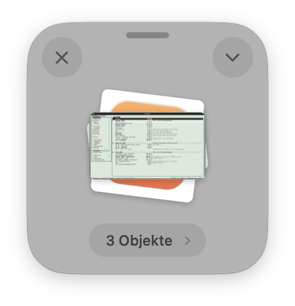
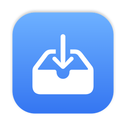

# DropMe: Ein kleines Fenster, das sich richtig anfühlen soll

*Dropover hat bei jeder Aktion nach Hause telefoniert. Also habe ich mir meine eigene Ablage gebaut und dabei vor allem an den Details gefeilt, die man kaum sieht, aber spürt.*



*DropMe mit drei Demodateien. Oben links schließen, oben rechts das Aktionsmenü, unten die Pille.*

Ich mag Werkzeuge, die genau eine Sache gut machen und dabei nicht im Weg stehen. Dropover war so eins: Man zieht Dateien, hält die Umschalttaste, und unter dem Mauszeiger erscheint eine kleine Ablage. Dort sammelt man ein paar Dateien aus verschiedenen Ordnern und zieht sie später gemeinsam weiter, in eine Mail, in Figma oder in einen anderen Ordner. Ich hatte die App gekauft und gern benutzt.

Dann sah ich, dass sie bei jeder Aktion Daten verschickt. Claude hat die App daraufhin für mich auseinandergenommen: Fest eingebaut ist Sentry, ein Dienst für Fehlerberichte, der Abläufe in der App mitschreibt und an `ingest.de.sentry.io` schickt. Dazu kommen ein Logging-Baustein, der Protokolle in eine Cloud schicken kann, und Anbindungen an Dropbox, Google Drive, OneDrive, Imgur und S3. Den Schalter „Online-Funktionen deaktivieren“ gibt es zwar, Sentry steckt aber trotzdem drin.

Für eine Ablage, die nichts anderes tun soll, als ein paar Dateipfade festzuhalten, war mir das zu viel. Ich wollte eine eigene, private Version, als Open Source und ohne eine einzige Zeile Netzwerkcode.

## Nach Screenshots gebaut

Den Anfang machten meine Screenshots von Dropover. Claude baute daraus die erste Fassung: ein Glasfenster mit Schließen links, Chevron rechts, gefächerter Vorschau und einer Namens-Pille unten. Das Ziehen mit gedrückter Umschalttaste schaut sich nur an, welche Typen in der Zwischenablage des Ziehens liegen, nie den Inhalt.

Mein erstes Urteil war „bisschen rough noch, aber sonst super“. Genau dieses „rough“ ist der Teil, der mich als UI Designer interessiert. Funktionen hat man schnell, das Gefühl dauert länger.

## Die Details, die man spürt

Das Fenster misst 200 × 210 Punkt und hat einen Eckradius von 34. Ab macOS 26 liegt es als echtes Liquid Glass auf dem Schreibtisch, auf älteren Systemen als die gewohnte Milchglasfläche. Oben sitzt ein kleiner Griff, damit klar ist, dass man das Fenster verschieben kann, die beiden runden Knöpfe sind 34 Punkt groß und werden beim Überfahren etwas heller.

Die Vorschau ist ein Fächer, kein Raster. Die Dateien liegen leicht gedreht übereinander, wie Papier auf einem Tisch. Echte Vorschaubilder bekommen einen weißen Rand mit kleinem Radius und einen Schatten, Symbole bleiben, wie sie sind. So erkennt man auf einen Blick, ob da Bilder liegen oder Dokumente.

Die Pille unten nennt bei einer Datei den Namen und bei mehreren die Anzahl. Ein Klick listet die einzelnen Dateien, zum Öffnen, Zeigen oder Entfernen.

## Bewegung, aber zurückhaltend

Für die zweite Runde bat ich um „ein paar ganz subtile Animationen und Transitions“. Herausgekommen ist das:

- Das Fenster blendet in 0,16 Sekunden ein und federt dabei aus 92 Prozent seiner Größe auf. Beim Schließen schrumpft es minimal und blendet aus.
- Zieht man Dateien darüber, leuchtet die Fläche weich auf und der Stapel federt kurz.
- Die Pille gleitet auf ihre neue Breite, der Text wechselt per Überblenden.

Wer in macOS „Bewegung reduzieren“ eingeschaltet hat, bekommt nur noch das Überblenden. Das war mir wichtig: Bewegung soll erklären, was passiert, und niemanden stören, der keine will.

Eine Kleinigkeit hat dabei einen eigenen Anlauf gekostet. Animierte AppKit die Größe der Pille mitsamt Inhalt, blieb der Text manchmal auf der alten Breite stehen. Jetzt wird nur der Rahmen animiert, und der Inhalt richtet sich danach.

## Was ich weggelassen habe

Keine Cloud, kein Konto, keine Synchronisation. Teilen läuft über die Dienste von macOS, also AirDrop, Mail, Nachrichten und Notizen. DropMe selbst schickt nichts. Das lässt sich am Programm nachprüfen, ohne mir glauben zu müssen:

```
otool -L /Applications/DropMe.app/Contents/MacOS/DropMe
```

Dort taucht weder CFNetwork noch das Network-Framework auf.

Dafür gibt es etwas, das ich bei Dropover vermisst habe: Schnellziele. Das sind Ordner mit eigenem Namen, die direkt im Aktionsmenü stehen. Bei mir ist das die Ablage meiner Buchhaltungs-App, in die Belege wandern. Zwei Klicks, und die Datei liegt dort.



DropMe ist an einem Sonntag entstanden, vom ersten Commit bis Version 1.1.1 in acht Commits und rund 1.350 Zeilen Swift. Es läuft nur auf Apple Silicon, ist mit meiner Developer ID signiert und per Homebrew installierbar. Der Code liegt auf [GitHub](https://github.com/Wiredframe/dropme).
