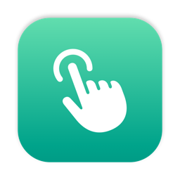

# Mittelklick: Der dritte Helfer an einem Sonntag

*Nach DropMe und Rectmangle lag es nahe, auch den Mittelklick selbst zu bauen. Herausgekommen sind 446 Zeilen, ein Framework, das es offiziell gar nicht gibt, und die Frage, wann ein Tippen kein Tippen ist.*

An jenem Sonntag hatte ich schon zwei meiner kleinen Helfer durch eigene ersetzt: die Ablage DropMe und den Fenstermanager Rectmangle. Beim Durchsehen der Menüleiste blieb mein Blick an Middle hängen. Das ist eine kleine App, die dem Trackpad einen Mittelklick beibringt, vom selben Hersteller wie Rectangle. Wenn ich schon dabei war, dann auch die.

Der Mittelklick ist eines dieser Dinge, die man erst vermisst, wenn sie fehlen: Links im Hintergrund öffnen, Tabs mit einem Klick schließen. Mit Maus selbstverständlich, mit Trackpad gar nicht vorgesehen.

## Ein Framework, das es nicht gibt

Für einen Mittelklick per Tippen muss die App sehen, wie viele Finger gerade auf dem Trackpad liegen. Eine offizielle Schnittstelle dafür hat macOS nicht. Es gibt aber ein privates Framework, `MultitouchSupport`, das die rohen Berührungen Bild für Bild liefert. Mittelklick lädt es erst zur Laufzeit. Fehlt es in einer künftigen macOS-Version, startet die App trotzdem und schreibt das ins Systemprotokoll.

Daraus wird ein Tippen, wenn genau die eingestellte Zahl von Fingern aufsetzt, sich kaum bewegt (höchstens 4 Prozent der Fläche) und innerhalb von 0,4 Sekunden wieder abhebt. Dann schickt Mittelklick einen Klick mit der mittleren Taste an die Stelle des Mauszeigers.

Voreingestellt sind vier Finger. Drei wären bequemer, kollidieren aber mit zwei Gesten von macOS, dem Nachschlagen per Dreifingertipp und dem Ziehen mit drei Fingern. Vier Finger sind frei.

## Wann ein Tippen kein Tippen ist

Die erste Version funktionierte, und gerade deshalb fiel schnell auf, wo sie zu eifrig war. Noch am selben Tag gab es eine Fehlerrunde:

- Drückte ich das Trackpad mit vier Fingern richtig herunter, also ein Klick statt eines Tippens, kam trotzdem ein Mittelklick dazu.
- Beim Tippen auf der Tastatur streifen die Handballen gern das Trackpad. Auch das wurde manchmal zum Mittelklick.

Jetzt passiert eine halbe Sekunde nach einem Tastendruck oder Linksklick gar nichts. Abgefragt wird dafür nur die Zeit des letzten Tastendrucks, nie die Taste selbst. Eine App, die mitbekommt, was ich tippe, wollte ich auf keinen Fall.

Dazu kamen Bluetooth-Trackpads, die nach dem Verbinden erkannt werden, und halbe Gesten, die nach dem Aufwachen aus dem Ruhezustand hängen blieben und jetzt verworfen werden. Für den Fall, dass doch einmal etwas nicht stimmt, gibt es ein Protokoll, das jede Geste mit Fingerzahl, Dauer und Ergebnis aufschreibt.

## Klein mit Absicht

Mittelklick hat kein Fenster, nur ein Menü in der Menüleiste: Fingerzahl, Start beim Anmelden, Symbol ausblenden. Wer lieber klickt als tippt, kann zusätzlich Fn und Linksklick als Mittelklick nehmen, Ziehen eingeschlossen. Dieser Teil sieht nur Mausereignisse, nie die Tastatur.

Wie die beiden anderen kommt Mittelklick ohne Netzwerkcode, Konto und Telemetrie aus. Vom Trackpad liest die App nur Position und Zustand der Berührungen und vergisst sie sofort wieder.

Gerade hier merke ich, warum ich solche Werkzeuge gern selbst baue. Ich brauche genau eine Geste, und die soll zuverlässig sein, nachvollziehbar und so klein, dass ich den ganzen Code an einem Abend lesen könnte. Bei 446 Zeilen Swift geht das.

Mittelklick kam in fünf Commits von Version 1.0.0 bis 1.0.3. Der Code liegt auf [GitHub](https://github.com/Wiredframe/mittelklick).
