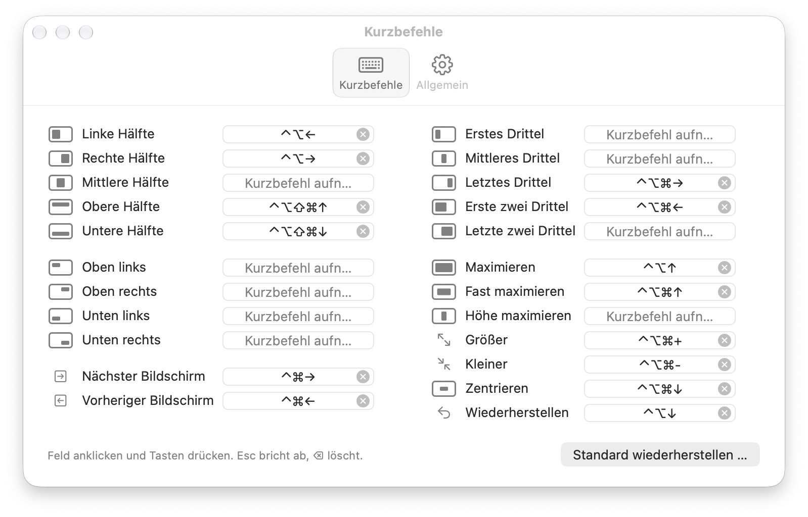
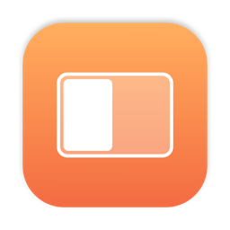

# Rectmangle: Vom Config-File zum Einstellungsfenster

*Ein Fenstermanager ohne Lizenzcheck war schnell gebaut. Benutzbar wurde er erst, als ich ihn mit den Augen eines UI Designers angeschaut habe.*

*Jede Aktion mit einem kleinen Bild ihrer Position und einem Feld, in das man das Kürzel einfach drückt.*

Fenster per Tastatur in Hälften, Drittel und Ecken zu schieben, gehört für mich zum Arbeiten wie Kopieren und Einfügen. Dafür hatte ich Rectangle, zuletzt die gekaufte Pro-Version. Was mich störte: Sie braucht eine Internetverbindung, um die Lizenz zu prüfen. Ein Werkzeug, das Fenster verschiebt, hat im Netz nichts verloren.

Also habe ich Claude gebeten, einen minimalistischen Nachbau zu machen, für mich und als Open Source.

## Meine Einstellungen, eins zu eins

Ich hatte einen Screenshot meiner Kürzel mitgeschickt. Claude las sie aber gleich direkt aus den Einstellungen von Rectangle aus und fand dabei noch zwei, die im Screenshot eingeklappt waren. Auch die Feinheiten kamen mit: Drückt man ein zweites Mal auf „linke Hälfte“, wandert das Fenster auf den Bildschirm daneben, „fast maximieren“ nutzt 90 Prozent der Fläche, und der Mauszeiger folgt dem Fenster auf einen anderen Bildschirm. Die Bereiche zum Andocken am Bildschirmrand hatte ich in Rectangle abgeschaltet, also gibt es sie in Rectmangle gar nicht erst.

Version 1.0 hatte kein Einstellungsfenster. Alles stand in einer Datei, `~/.config/rectmangle/config.json`, die beim Speichern sofort neu geladen wird. Für einen Entwickler ist das elegant. Für mich war es ehrlich gesagt etwas rough.

## Das Auge des Designers

Eine Datei ist eine Schnittstelle, aber keine Oberfläche. Man muss wissen, wie ein Kürzel geschrieben wird, ob `⌃⌥←` oder `ctrl+opt+left`, und man sieht erst nach dem Speichern, ob es geklappt hat. Dazu fehlte der App etwas, das DropMe und Mittelklick vom selben Tag schon hatten: ein eigenes Symbol und ein Menü in der Menüleiste.

Also kam das in zwei Schritten dazu. Zuerst Symbol und Menü, in dem jede Aktion mit ihrem Kürzel steht. Dann das Einstellungsfenster, nach dem Vorbild von Rectangle:

- Jede Aktion hat ein kleines Bild, das zeigt, wo das Fenster landet. Man muss „Erste zwei Drittel“ nicht lesen, man sieht es.
- Ins Feld klicken, Tasten drücken, fertig. Esc bricht ab, die Rückschritt-Taste löscht.
- Ist ein Kürzel schon vergeben, lehnt das Feld es ab und sagt, für welche Aktion. Belegt eine andere App das Kürzel, steht ein Warnsymbol in der Zeile.
- Ein zweiter Reiter regelt den Rest: Start beim Anmelden, Menüleistensymbol, die Größe von „fast maximieren“ und die Schrittweite für Größer und Kleiner.

Die Datei ist dabei geblieben. Das Fenster schreibt sie neu, in fester Reihenfolge, und von Hand bearbeiten kann man sie weiterhin. Eine einzige Quelle für alle Einstellungen, zwei Wege dorthin.

## Was die Prüfung fand

Nach jeder Stufe lasse ich eine Fehlerrunde laufen, inklusive einer unabhängigen Durchsicht. Beim Einstellungsfenster fand sie unter anderem:

- Ein Kürzel auf der Taste „#“ ließ sich nach dem Speichern nicht mehr einlesen.
- Wechselte man während einer Aufnahme den Reiter, nahm das Feld unsichtbar weiter auf.
- Kürzel nur mit ⌘ oder nur mit ⌥ hätten in allen Apps zum Beispiel ⌘C oder das Tippen von „€“ blockiert. Sie werden jetzt abgelehnt.

Schön fand ich einen Nebeneffekt aus dem Testen. Claude darf keine Tasten drücken, konnte die Kürzel also nicht selbst ausprobieren. Stattdessen bekam Rectmangle ein URL-Schema, `open -g rectmangle://leftHalf`, mit dem Claude jede Aktion an einem Finder-Fenster durchspielte. Heute ist das eine Funktion: Man kann Rectmangle damit aus Raycast oder der Kurzbefehle-App steuern.

## Ein Nachspiel am nächsten Tag

Am Montag fiel auf, dass alle drei Apps vom Sonntag im alten Fensterlook erschienen, mit kleinen Ampeln. Der Grund war unscheinbar: Das Build-Werkzeug hatte das Mindestsystem als SDK-Version eingetragen, und macOS hielt die Apps deshalb für alt. Seit einem Linker-Schalter zeigen sie das aktuelle Design, so wie im Screenshot oben.

Rectmangle hat in einem Tag sieben Versionen bekommen, in elf Commits und rund 1.700 Zeilen Swift. Was fehlt, fehlt bewusst: Andocken am Bildschirmrand, Abstände zwischen Fenstern und Ausnahmen pro App. Der Code liegt auf [GitHub](https://github.com/Wiredframe/rectmangle).
