# wiredframe: Meine Arbeit in einer Terminal-App, und ein Rückgängig, dem ich vertraue

*Nach gut zehn Stunden lief die erste Version mit meinen echten Daten. Die Wochen danach gehörten vor allem einer Frage: Was passiert, wenn etwas schiefgeht?*

„Gibt es fürs CLI eine Art PIM mit Mail, Kalender und Tasks?“

Am 24. September wollte ich nur wissen, ob es so etwas schon gibt. Zwei Tage später hatte ich eine eigene App. Drei Wochen später lief darüber meine komplette Selbstständigkeit: Zeiten, Rechnungen, Ausgaben, Kontoauszüge, Steuern, Mail, Termine, Notizen.

Bis dahin steckte mein Arbeitsalltag in einem halben Dutzend Programmen. Zeiten in WorkingHours, Rechnungen in SubTotal, Ausgaben und Steuern in meiner eigenen App Kontor; dazu ein paar Python-Skripte und Skills für Claude. Claude zeichnete mir ein Diagramm davon. Es sah aus wie ein Kabelsalat: Jedes Programm kannte seinen Teil. Welche Mail zu welchem Projekt gehörte und welche Zeit auf welcher Rechnung landete, wusste nur ich.

Ich bin kein Senior Developer. Claude schrieb den Code, die Tests und die Dokumentation. Ich entschied, was die App können soll, benutzte sie jeden Tag und sagte, wo es hakt. Das Ergebnis heißt wiredframe. Von außen sieht man eine Terminal-App. Darunter steckt die eigentliche Arbeit: Daten miteinander zu verbinden und dafür zu sorgen, dass nichts verloren geht.

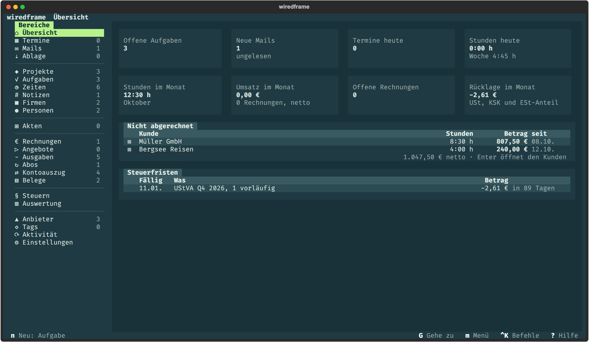

*Die Übersicht beim Start. Alle Bilder in diesem Beitrag zeigen Demodaten; wiredframe läuft offline in einem eigenen Ordner.*

## Ein Graph statt sechs Programme

Der Satz, mit dem ich Claude das Projekt beschrieben habe, steht heute noch oben in der README: *The frame holds everything. The wires connect everything.*

Jeder Datensatz (Kunde, Aufgabe, Zeitbuchung, Mail oder Beleg) hat eine gemeinsame Identität: eine ULID, eine zeitlich sortierbare ID mit 26 Zeichen. Eine Aufgabe lässt sich zum Beispiel als `wf:task/01M4X…` adressieren. Die Fachtabellen der Module hängen mit demselben Schlüssel an einer gemeinsamen Tabelle namens `entities`.

Die Verbindungen zwischen den Modulen heißen Wires. Ein Wire ist eine Zeile mit Quelle, Art und Ziel. Fremdschlüssel über Modulgrenzen hinweg gibt es nicht. Stattdessen bringt jede Art von Wire ihre eigenen Regeln mit: Eine Aufgabe gehört zu höchstens einem Projekt (`max_targets`), eine Zeitbuchung wird höchstens einmal abgerechnet (`max_sources`). Manche Wires bilden den Kontext: einen gerichteten Graphen ohne Kreise, den der Kern selbst bewacht.

Dieser Kontext macht die App nützlich. Eine Zeitbuchung kennt ihren Kunden, auch wenn dazwischen Aufgabe und Projekt liegen. Ein Projekt zeigt die Mails, Notizen und Rechnungen, die irgendwo darunter hängen. Lege ich aus einer Mail eine Aufgabe an, übernimmt sie automatisch das Projekt der Mail und die beteiligten Personen.

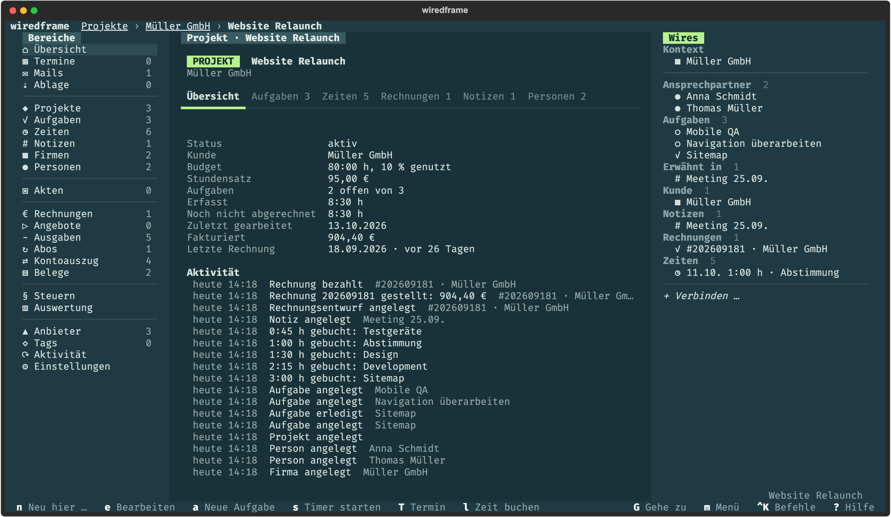

*Ein Projekt: rechts die Wires, oben der Pfad über den Kunden. Die Kennzahlen in der Mitte steuern die Module bei, die das Projekt selbst gar nicht kennt.*

Eine Regel hält diese Architektur zusammen: Die Module importieren einander nicht, und der Kern kennt kein einziges Modul. Ein Test prüft das bei jedem Lauf. Er weiß, welche Datei zu welchem Modul gehört und welche Tabelle wem. Sobald ein Modul SQL auf eine fremde Tabelle richtet oder der Kern einen Modulnamen auch nur als Text enthält, schlägt er Alarm. Die Regel klingt streng. Sie ist der Grund, warum ich auch nach drei Wochen neue Module ergänzen kann, ohne dass an anderer Stelle etwas umfällt.

## Ein Befehl, vier Oberflächen

Jede Funktion ist ein `Command` mit typisierten Parametern: Text, Datum, Dauer, Geldbetrag, Datensatz und so weiter. Aus diesem einen Befehl entstehen das Kontextmenü, ein Formular mit passenden Eingabefeldern, der Eintrag in der Befehlspalette, die Hilfe und der Aufruf über die Kommandozeile `wf`.

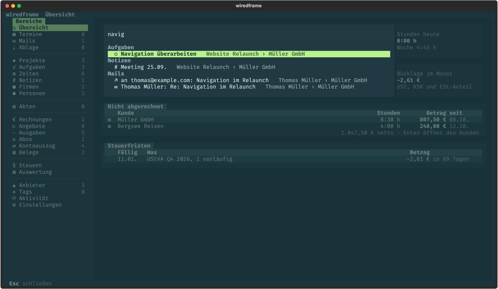

*Ctrl+K sucht überall. Die Treffer zeigen ihren Kontext. Ein FTS5-Index findet auch „navig“, wenn ich nach einem Wort mit Umlaut oder anderer Endung suche.*

Für mich heißt das: Die Bedienung fühlt sich überall gleich an. Für Claude heißt es: Er kann alles, was ich in der Oberfläche kann, auch über `wf run` erledigen. Arbeitet er gerade mit meinen Daten, steht es unten in der Tastenleiste: „● Claude liest Rechnungen September“. Ändert er etwas, lädt die App neu. Ein eigenes KI-Modul braucht wiredframe nicht. Für wiederkehrende Abläufe (den Tagesabschluss, das Einsortieren von Scans, die Steuererklärung) gibt es Skills, die über die Kommandozeile arbeiten.

Formulare öffnen sich in einer rechten Seitenleiste statt in Dialogen. Die Eingaben werden zentral ausgewertet: „1:30“, „1,5“ und „90m“ bedeuten dieselbe Dauer; „Freitag“ ist der nächste Freitag. Fehlt ein Kunde, kann ich ihn direkt im Feld anlegen. Danach springt das Formular an seine Stelle zurück.

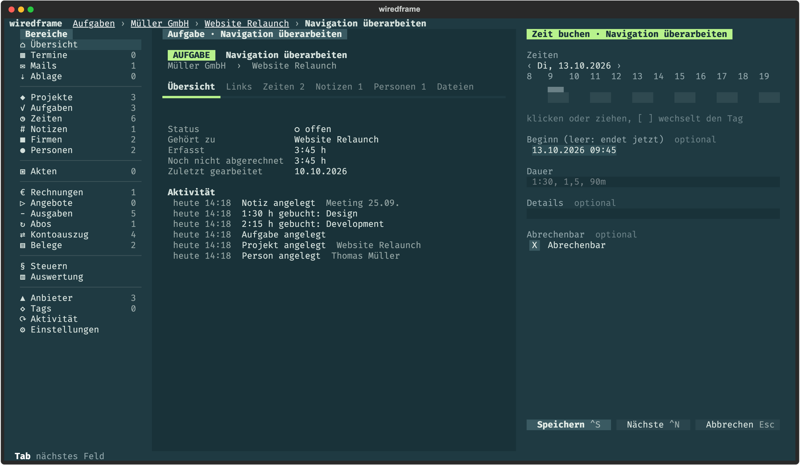

*Zeit buchen an einer Aufgabe. Der Zeitstrahl kommt aus WorkingHours; die Seitenleiste ersetzt Dialoge überall in der App.*

Auch die Hilfe gehört zum Befehl. `?` zeigt für jede Ansicht einen kurzen Text und die dort gültigen Tasten. Die Tastenkürzel im Text sind Platzhalter, die aus den Befehlen gefüllt werden. Ändert sich die Bedienung, aber nicht die Hilfe, fällt das beim Test auf.

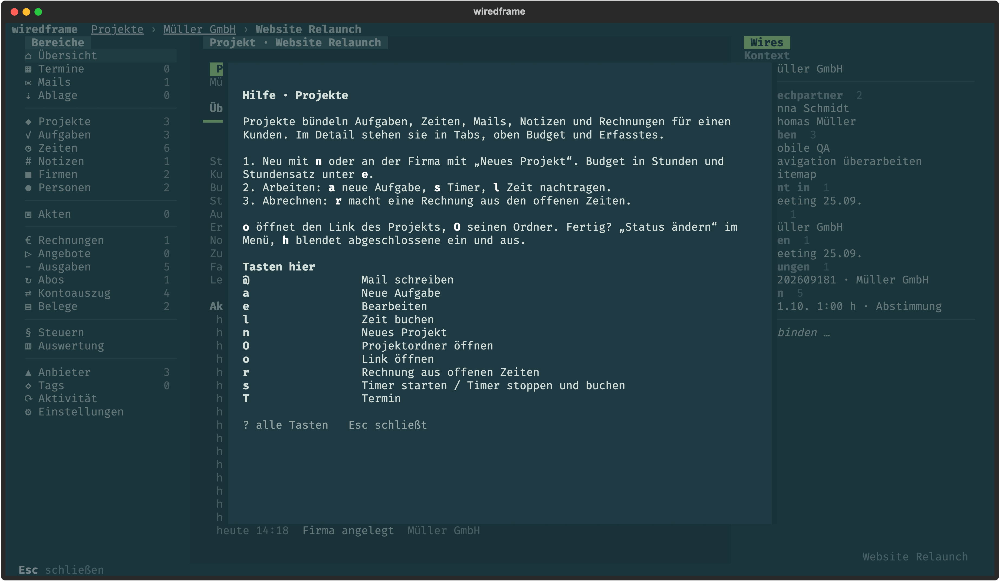

## Von der Idee zum Produktivbetrieb in zehn Stunden

Am 26. September um 10:26 Uhr kam der erste Commit: Kern, sechs Module, Oberfläche und Kommandozeile. Um 20:46 Uhr markierten wir Version 1.0 und übernahmen meine echten Daten aus WorkingHours, SubTotal und Kontor.

So schnell ging es auch deshalb, weil wir die alten Programme nicht nachgebaut haben. Ich ließ Claude Screenshots davon machen und als Referenz für die Bedienung verwenden. Das Datenmodell bekam von Anfang an eine eigene Form. Der Import lief genau einmal, danach flog er wieder aus dem Code.

Seit diesem Abend sind Entwicklung und Alltag getrennt. Entwickelt wird im Projektordner, mit Testdaten. Meine echte Installation läuft aus einem eigenen Git-Worktree auf einer markierten Version. Was Claude baut, landet erst dann bei mir, wenn ich es freigebe.

## Geld ist kein float

Wenn eine App Rechnungen stellt und Zahlen für die Steuererklärung liefert, ist Rechnen keine Nebensache. Beträge stehen in ganzen Cent, Mengen in Tausendsteln, Steuersätze in Basispunkten: 1900 entspricht 19 Prozent. Gerundet wird kaufmännisch; Fließkommazahlen kommen im Rechenweg nicht vor.

Auch gestellte Rechnungen schützt die Datenbank selbst. SQLite-Trigger halten Art und Status einer gestellten Rechnung fest und bewahren Nummer und Datum ab dem Versand, selbst wenn jemand direkt per SQL in die Datenbank schreibt. Abgerechnete Zeiten lassen sich danach nur noch in der Beschreibung ändern. Vor dem Stellen wird die E-Rechnung nach ZUGFeRD gegen die offiziellen Regeln geprüft.

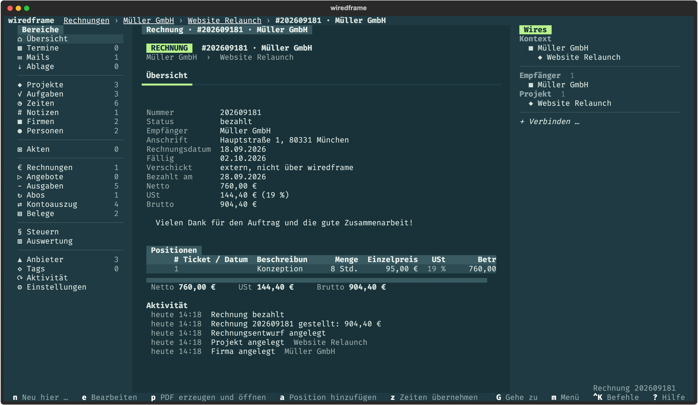

Die Steuerberechnung besteht aus reinen Funktionen auf Posten in Cent: Umsatzsteuer-Voranmeldung, Zusammenfassende Meldung, EÜR, Rücklage. Für die Jahreserklärung liefert `wf export steuer` die Zahlen. Ein Skill macht daraus die Formularzeilen, Claude füllt Mein ELSTER im Browser aus, bis kurz vor dem Absenden. Den letzten Knopf drücke ich selbst.

Bei der Gelegenheit fiel auf, dass beim Umzug aus Kontor einige Bankbuchungen doppelt hereingekommen waren: einmal mit kurzem, einmal mit langem Schlüssel. Seit Version 1.27.1 erkennt der Import beide Schlüssel als bereits bekannt. Ohne die Vorprüfung vor ELSTER wäre mir das womöglich erst im Steuerbescheid aufgefallen.

## Rückgängig, ernst gemeint

Wenn ich einer App meine Buchhaltung anvertraue, will ich jeden Schritt zurücknehmen können. Einen Tippfehler. Eine gerade angelegte Rechnung. Einen gelöschten Kunden. Oder zwanzig Mails, die ich dem falschen Projekt zugeordnet habe.

Jeder Befehl läuft deshalb über `Frame.run` und wird als Aktion aufgezeichnet. Temporäre Trigger auf allen Fachtabellen sichern vor jeder Änderung den bisherigen Zustand einer Zeile. Rückgängig spielt diese Zustände in umgekehrter Reihenfolge zurück, innerhalb einer Transaktion und mit verzögerter Prüfung der Fremdschlüssel. Das ist nötig, weil Kaskaden Kindzeilen vor ihren Eltern löschen können. Danach prüft `PRAGMA foreign_key_check` die berührten Tabellen. Stimmt etwas nicht, scheitert der ganze Schritt sauber, statt halb zu gelingen.

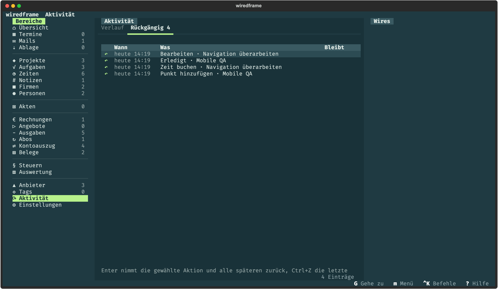

*Aktivität › Rückgängig. Enter nimmt die gewählte Aktion und alle späteren zurück; Ctrl+Z die letzte.*

Natürlich lässt sich nicht alles zurücknehmen. Eine gesendete Mail bleibt gesendet. Solche Befehle setzen eine Grenze im Stapel. Ctrl+Z hält dort an und sagt warum, statt still die Aktion davor zurückzunehmen.

Seit es die Ablage gibt, gilt das auch für Dateien: Wird ein Scan als Beleg einsortiert, holt Rückgängig die Datei zurück, zusammen mit der Änderung in der Datenbank. Beim Verschieben wird der Zielname exklusiv belegt, durch einen harten Link oder eine exklusiv angelegte Kopie. Vorhandenes wird niemals überschrieben, auch kein kaputter Symlink.

Den wichtigsten Fehler in diesem Teil fanden wir am 12. Oktober in einer Kopie meiner echten Daten. Rückgängig hatte geänderte Zeilen über ihre `rowid` wiedergefunden. SQLite kann diese Nummer aber neu vergeben, wenn vorher etwas ohne Aufzeichnung gelöscht wurde. Das konkrete Szenario: Ich verwerfe eine Notiz. Im Hintergrund gleicht der Kalender einen Termin ab und bekommt dieselbe rowid. Nehme ich dann das Verwerfen zurück, könnte der Termin verschwinden.

Das ist nie passiert. Aber es hätte passieren können, und genau dafür gibt es Rückgängig. Seitdem läuft die Zuordnung über Primärschlüssel. Für ältere Aufzeichnungen ohne Schlüssel gibt es einen vorsichtigen Abgleich über den Inhalt. Was sich damit nicht eindeutig zuordnen lässt, bleibt stehen. Die Meldung sagt dann „1 Eintrag nicht mehr zuzuordnen“, statt Erfolg vorzutäuschen.

## Sicherungen, Freigaben und Migrationen

Sicherungen erstellt wiredframe über die Backup-API von SQLite und eine eigene, nur lesende Verbindung. Eine läuft täglich beim Start, eine weitere vor jedem Import eines Kontoauszugs. Die letzten sieben liegen zusätzlich in meinem Vault. Vor jeder Wiederherstellung wird auch der aktuelle Stand gesichert.

Freigegeben wird mit `wiredframe update`. Das Skript prüft, ob die markierte Version zur Version in `pyproject.toml` passt, und bricht ab, solange die App noch läuft, denn ihre Rückgängig-Trigger kennen die alten Tabellen nicht. Dann checkt es die Version in einem frischen Worktree aus, lässt dort die komplette Testsuite laufen, sichert die Datenbank und stellt erst danach die produktive Installation um. Zum Schluss nennt es den Weg zurück.

Schlagen die Tests fehl, ändert sich nichts. Einmal haben wir eine Version wegen Abstürzen komplett zurückgerollt. Es beruhigt, dass der Weg zurück im Skript steht und nicht in meinem Kopf.

Migrationen laufen beim Start automatisch und sind je Modul versioniert. Vor jeder Schemaänderung gibt es eine Sicherung; jede Migration wird zuerst an einer Kopie meiner echten Daten geprüft. Auch dabei fand die letzte Runde noch etwas: Starteten App und `wf` nach einem Update gleichzeitig, wollten beide dieselbe Migration anwenden. Jetzt trägt eine Migration ihre Version unter der Schreibsperre ein, bevor sie beginnt.

Für Experimente gibt es zwei Schalter. `WIREDFRAME_HOME` zeigt auf einen anderen Datenordner. `WIREDFRAME_OFFLINE=1` lässt jeden Zugriff auf Mail, Kalender und Kontakte mit einer Meldung abbrechen. Die Tests setzen beides immer; außerdem legen sie nichts in meinen echten Papierkorb. Inzwischen sind es 823 Tests, die parallel in gut 20 Sekunden durchlaufen.

## Wenn draußen etwas fehlt

Die heiklen Fälle liegen oft am Rand der App: iCloud ist nicht erreichbar, ein anderes Programm hat eine Datei geändert, ein Server antwortet nur halb. Für solche Fälle gilt eine Regel: Fehlt etwas Großes, ändere nichts.

- Fehlt der Ablageordner, weil das Laufwerk gerade nicht da ist, löscht der Abgleich nicht alle Datensätze, um sie später neu anzulegen. Er tut gar nichts.
- Wirkt der Notizordner plötzlich leer, archiviert wiredframe nicht sämtliche Notizen. Eine einzelne fehlende Datei schon.
- Liefert der Kalender eine unvollständige Antwort, entfernt der Abgleich keinen Termin.
- Ist eine Notiz zugleich in Obsidian geöffnet, überschreibt das automatische Speichern die Änderungen dort nicht. Es übernimmt sie oder fragt nach.
- Hat eine Bank-CSV ein einzelnes Anführungszeichen ohne Gegenstück, verschluckt das nicht mehr still alle folgenden Buchungen. Nur diese Zeile fällt weg, und die Meldung sagt es.

Dazu kommen Dinge, die erst im Alltag auffallen: der 25-Stunden-Tag am Ende der Sommerzeit, Notizen in Latin-1, Kontoauszüge in Windows-1252, in denen das Euro-Zeichen plötzlich als Steuerzeichen auftaucht.

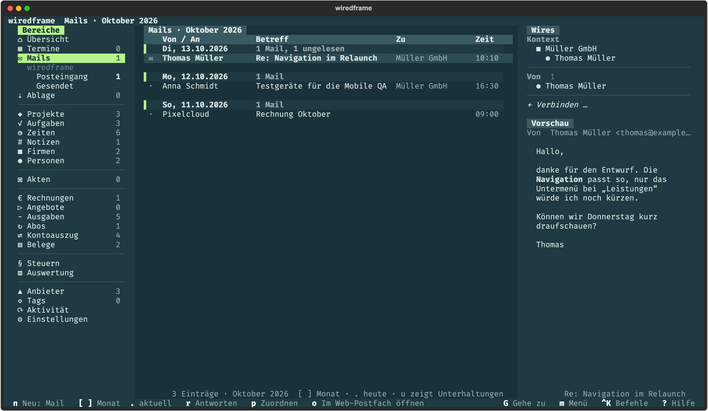

*Mails nach Monat, rechts Zuordnung und Vorschau. HTML-Mails zeigt wiredframe als Markdown; Bilder erscheinen nur als Alt-Text, Inhalte von außen werden nicht geladen.*

Bei Mail ging es auch um Sicherheit. Push läuft über IMAP IDLE, aber nur wie eine Klingel: Die Verbindung ist schreibgeschützt und meldet, dass etwas Neues da ist. Abgeholt wird es auf dem normalen Weg. Tokens holt genau eine Stelle im Code. Links aus Mails öffnen nur noch Webseiten und Mail-Adressen. Zuvor hätte ein `file:`-Link per Klick an `open` gehen und damit ein Programm starten können. Bei Links aus meinen eigenen Notizen ist die Regel etwas lockerer: Ordner und gängige Dokumente gehen auf; Programme, Skripte und Pakete zeigt nur der Finder.

## Nächte mit Agenten

Neben neuen Funktionen gab es drei große Runden, deren einziges Ziel Qualität war. Claude arbeitete sie nachts mit mehreren Agenten ab. Jeder hatte einen eigenen Bereich und einen eigenen Git-Worktree.

**Verschlankung (1. auf 2. Oktober).** Nach einer langen Prüfung im Alltag wünschte ich mir „eine mächtige, aber schlanke App“. Als Prüfnetz diente ein Schnappschussvergleich: Die App rendert jede Ansicht offline und mit festgehaltener Uhrzeit, einmal mit Demodaten, einmal mit einer Kopie meiner echten Daten, jeweils vor und nach dem Umbau. Am Ende gab es null Unterschiede und deutlich weniger Code.

**Review (5. auf 6. Oktober).** Acht Agenten, einer je Bereich. Danach war der rekursive Weg durch den Kontext gut 15-mal schneller: 0,35 statt 0,02 Millisekunden je Schritt. Die Ausgabenliste mit mehr als 1.200 Einträgen lud in 36 statt 215 Millisekunden. Nebenbei kamen viele kleine echte Fehler ans Licht, bis hin zur Zeitumstellung.

**Hardening (12. Oktober).** Sieben Agenten, dazwischen zwei unabhängige Prüfungen und Fix-Runden. Aus dieser Runde stammt der Fund mit der rowid.

Eine Regel hat sich dabei bewährt. Bei größeren Vorhaben bitte ich Claude nach jeder Stufe um eine Bugfix-Runde: erst eine eigene Durchsicht, dann eine unabhängige Prüfung durch einen zweiten Agenten, der nur liest. Bestätigte Fehler bekommen einen Regressionstest. Erst danach geht es weiter. Jedes Mal haben diese Runden echte Fehler gefunden.

Ganz ohne Lehrgeld ging es nicht. Meine Einstellungen enthalten absolute Pfade in meinen Vault, für Sicherungen, Belege und Notizen. In einer Kopie meiner echten Daten stehen sie natürlich ebenfalls. Ein Agent spiegelte dadurch einmal eine Sicherung aus seiner Testkopie in meinen echten Vault. Es ging nichts verloren. Seitdem werden diese Pfade vor jedem Start einer Kopie umgebogen: nicht nur in den Einstellungen, sondern auch in den Tabellenzeilen, die auf Dateien zeigen.

## Was ich bewusst nicht gebaut habe

Am zweiten Tag schrieb ich Claude: „Diese Überspezifizität ist zu custom tailored. Die Software sollte ja für jeden gut funktionieren, reduziert und fokussiert.“ Danach flogen Monatsabschluss, private Budgets, ein JIRA-Export und eine Drop-Area für Belege wieder heraus. Die Künstlersozialkasse wurde zu allgemeinen Vorsorgeaufwendungen.

Eine native Mac-Oberfläche haben wir zweimal versucht. Der erste SwiftUI-Prototyp verlor für mich „unglaublich viel von seinem utilitarian Charme“. Am 9. Oktober ließ ich nach einem schönen Mockup trotzdem ein richtiges MVP bauen, mit `wf serve` als Prozess für den Datenzugriff. Das Mockup gefiel mir. Die echte App war im Alltag aber weder angenehm noch übersichtlich. Zwanzig Minuten nach dem Commit war alles zurückgenommen; der Versuch liegt auf einem eigenen Zweig. Für eine dichte Arbeitsoberfläche ist mir das Terminal lieber.

Kleiner, aber genauso ehrlich: Zebrastreifen im Finanzamt-Theme standen genau eine Minute in einer markierten Version.

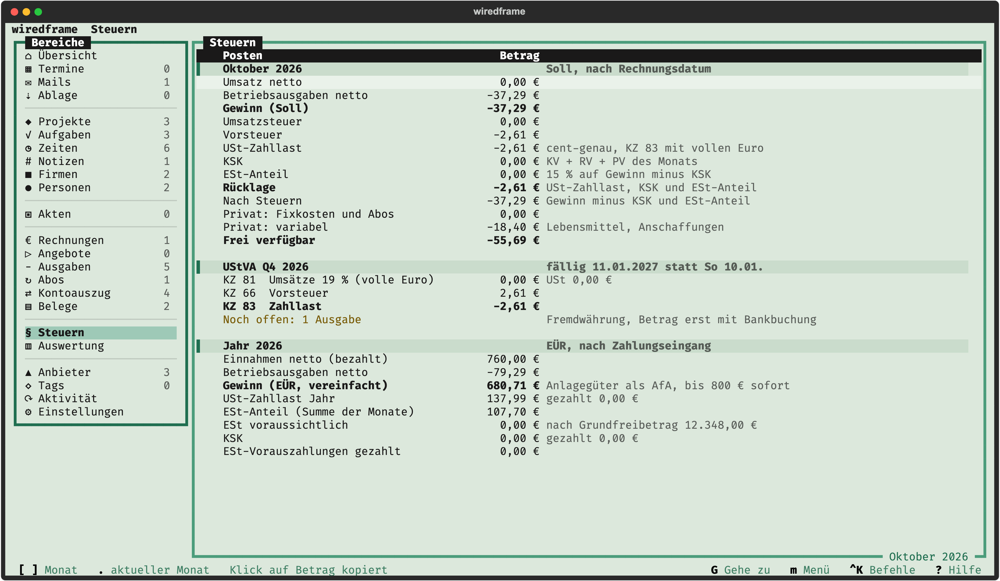

*Das Theme „finanzamt“, nach den Farben der Steuervordrucke. Aus Spaß entstanden, inzwischen mein Theme im Alltag.*

## Was aus der Frage geworden ist

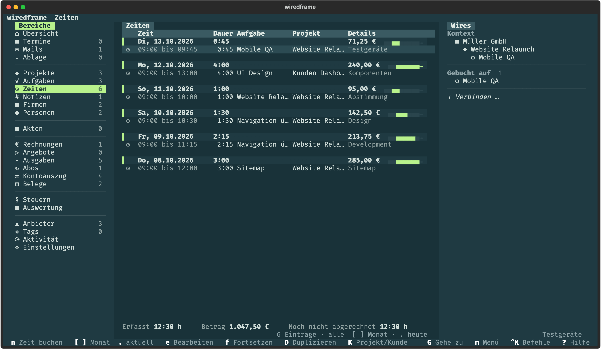

Zwischen der ersten Frage und heute liegen knapp drei Wochen, 581 Commits und 92 markierte Versionen. wiredframe hat etwa 27.000 Zeilen Python und 12.700 Zeilen Tests. Die App ist lokal: eine SQLite-Datei, ein paar Ordner, und Verbindungen zu meinen Konten nur über die Wege, die sich dafür als verlässlich erwiesen haben. Warum welcher Weg, steht in der Architektur. Ich hatte Claude darum gebeten, denn sonst weiß „in einem Jahr niemand mehr, was mit was wie zusammenhängt“.

Die Funktionen waren der leichtere Teil. Die längere Arbeit begann mit den Fragen danach. Was passiert, wenn die App zweimal läuft oder iCloud schläft? Was, wenn ich etwas zurücknehme, das schon zwei Schritte zurückliegt? Ich hätte nicht alle diese Fragen allein gestellt, geschweige denn beantwortet. Claude brachte viele selbst auf; in den Nachtrunden fanden die Agenten noch mehr.

Ich habe gelernt, was ein Savepoint ist, warum eine rowid keine Identität ist und weshalb man Migrationen besser an einer Kopie echter Daten prüft. Jedes Mal genau dann, wenn es darauf ankam.

Jetzt buche ich in wiredframe meine Zeiten, schreibe Rechnungen und lese Mails. Meistens denke ich dabei nicht an Trigger oder Grenzen im Stapel. Aber wenn ich Ctrl+Z drücke, weiß ich, dass es hält, was es verspricht.

## Nachträge

Kleine Verbesserungen aus dem Alltag, jeweils mit ihrem Datum.

### Ein Kontextmenü mit Ordnung (14. Oktober)

Jedes Modul darf Befehle an einen Datensatz hängen. Mit der Zeit machte das eine Mail-Menü unübersichtlich: Mail, Belege, Akten und Kontakte legten ihre Befehle in denselben Abschnitt „Aktionen“, sortiert wurde nur nach einer Zahl. So stand „Als gelesen markieren“ zwischen zwei Rechnungsbefehlen. „Kommentar“ bekam sogar einen Abschnitt für sich allein.

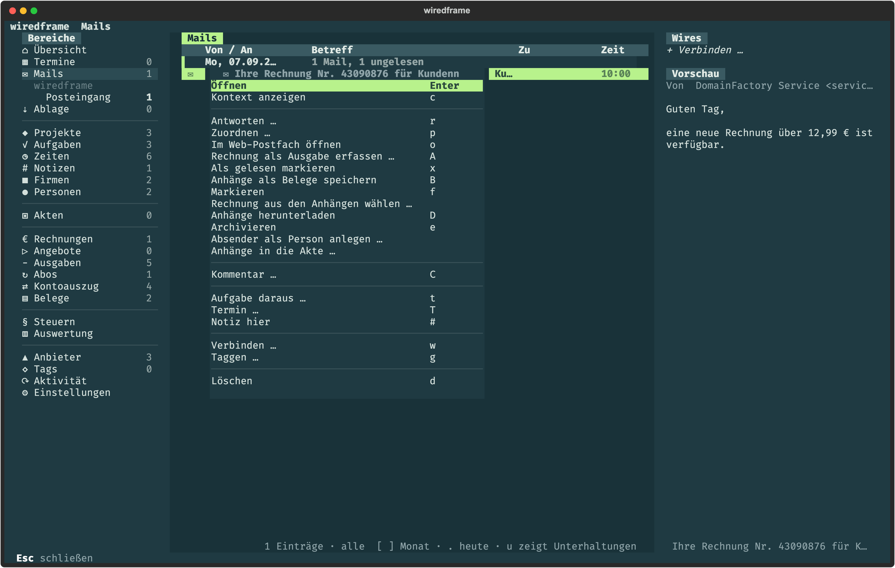

*Vorher: vierzehn Befehle in einem Block, Anhänge, Status und Rechnung im Wechsel.*

Jetzt gibt es feste Abschnitte, für alle Arten von Datensätzen in derselben Reihenfolge: zuerst, was man mit dem Datensatz tut; dann sein Status; danach Anhänge und Dateien; anschließend, was daraus entsteht; zuletzt Verbinden und Löschen. Ein Modul muss nur noch sagen, in welchen Abschnitt sein Befehl gehört. Die Tasten sind gleich geblieben, und die Leiste unten zeigt sie in derselben Reihenfolge wie das Menü.

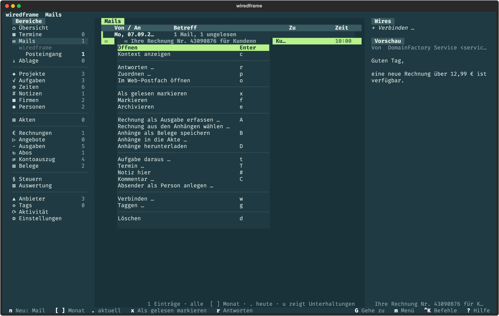

*Nachher: dieselben Befehle, nach Zweck gruppiert. Bei Aufgaben, Rechnungen, Angeboten und Terminen stehen die Statuswechsel ebenfalls in einem eigenen Block.*

### Suchtreffer nach Datum (15. Oktober)

Die Suche (`Ctrl+K`) zeigt je Kategorie die ersten fünf Treffer. Bisher entschied die Relevanz der Volltextsuche. Bei Belegen, Buchungen und Mails ist sie aber oft für alle Treffer gleich: Fünf Rechnungen von DomainFactory passen gleich gut auf „domainfactory“. So erschienen fünf Belege aus drei Jahren in beliebiger Reihenfolge, und die letzte Rechnung fehlte oft.

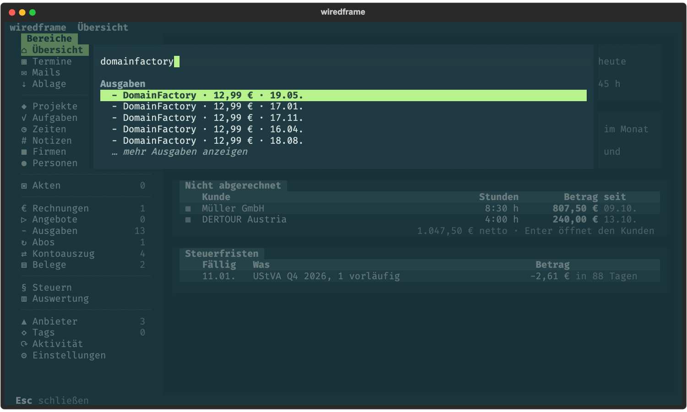

*Vorher: Mai, Januar, November, April, August, quer durch die Jahre.*

Jetzt bestimmt jede Art von Datensatz, welches Datum zählt: das Belegdatum bei Ausgaben, der Buchungstag beim Kontoauszug, der Eingang bei Mails, das Rechnungsdatum bei Rechnungen, der Beginn bei Zeiten und Terminen. Danach sortiert die Suche, neueste zuerst. Firmen, Personen, Projekte und andere Stammdaten bleiben nach Relevanz sortiert; dort ist der Name wichtiger als das Alter.

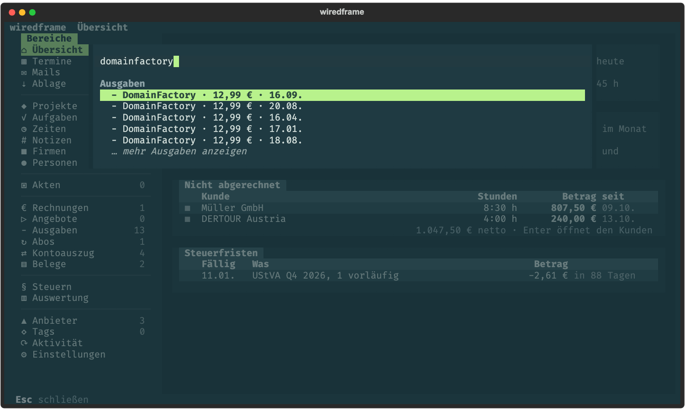

*Nachher: die fünf neuesten Treffer, absteigend sortiert.*

### Wann habe ich zuletzt von wem gehört? (19. Oktober)

Wer mit vielen Leuten gleichzeitig arbeitet, verliert manche aus den Augen. Nicht mit Absicht, sie rutschen einfach durch, weil gerade andere lauter sind. Die Personenliste half dabei nicht: alphabetisch sortiert, ohne Hinweis darauf, wann ich zuletzt Kontakt hatte.

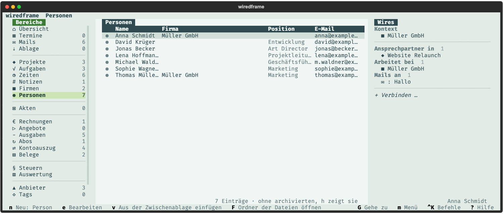

*Vorher: Name, Firma, Position, E-Mail. Wer seit Wochen nichts gehört hat, sieht genauso aus wie jemand von heute.*

Die Daten dafür waren schon da. Jede Mail ist über einen Wire mit Absender und Empfängern verbunden, jeder Termin mit seinen Teilnehmenden. Mail und Kalender liefern nun je eine Kennzahl: „Letzte Mail“ und „Letzter Termin“. Letzterer zählt nur vergangene Termine, denn ein geplanter Termin ist noch kein Kontakt. Die Personenliste nimmt das jüngste Datum und sortiert danach. Oben stehen die aktuellen Kontakte; je weiter unten jemand steht, desto eher sollte ich mich vielleicht melden. Feste Fristen gibt es bewusst nicht. Wie oft man mit wem spricht, ist zu verschieden.

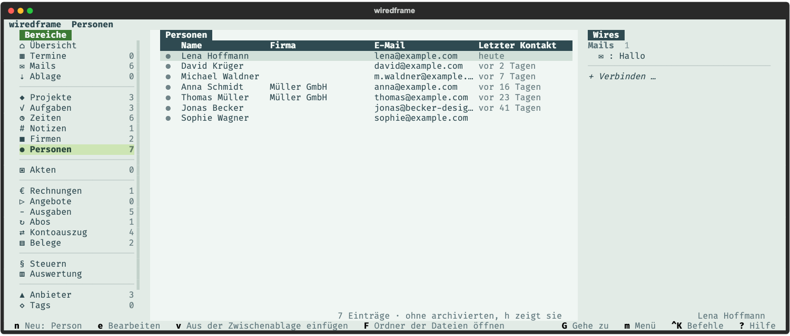

*Nachher: die Spalte „Letzter Kontakt“, neueste oben; Personen ohne Mail und Termin stehen am Ende. Die Position ist aus der Liste verschwunden, im Detail steht sie weiterhin.*

Architektonisch war das fast nichts: Kein Modul kennt ein anderes. Die Kontakte lesen nur zwei Kennzahlen, die Mail und Kalender ohnehin über den Kontext beisteuern können. Eine gebündelte Abfrage war vorbereitet, an einer Kopie der echten Daten aber unnötig: 67 Personen brauchen 44 Millisekunden. Und weil Personen im Kontext ihrer Firma stehen, zeigt auch die Firma ihre letzte Mail und ihren letzten Termin.

Die unabhängige Prüfung danach fand trotzdem einen Denkfehler. Eine Einladung hängt am Termin, und über den Kontext galt sie als Kontakt mit allen Teilnehmenden, selbst wenn der Termin erst nächste Woche stattfindet. Gezählt werden jetzt nur Mails, die wirklich von oder an die Person gingen, und Termine, an denen sie teilgenommen hat.

### Acht Agenten, ein Abend Feinschliff (19. Oktober)

Drei Wochen Alltag hatten eine Liste kleiner Ärgernisse hinterlassen. Für jedes allein hätte sich ein Abend kaum gelohnt. Also gab es eine größere Runde: acht Agenten, zuständig für Mail; Termine und Personen; Zeiten und Aufgaben; Rechnungen; Bank und Steuern; Akten und Ablage; Navigation und Tempo; Kern und Kommandozeile. Jeder arbeitete in einem eigenen Zweig und mit einer eigenen Kopie meiner echten Daten, offline und mit umgebogenen Pfaden.

Die Regel: erst ein Test, der den Fehler zeigt, dann der Fix. Keine neuen Funktionen, nur glätten. Danach sahen zwei unabhängige Prüfer den zusammengeführten Stand durch und fanden noch drei Fehler, darunter einen, den die Tests nicht entdecken konnten.

Ein paar Beispiele.

**Termine fangen bei heute an.** Wenn ich die Termine öffnete, landete ich am Monatsanfang und musste erst bis heute scrollen. Jetzt steht der Cursor auf dem ersten Termin ab heute. Das gilt auch für andere Listen, die vorwärts durch die Zeit laufen.

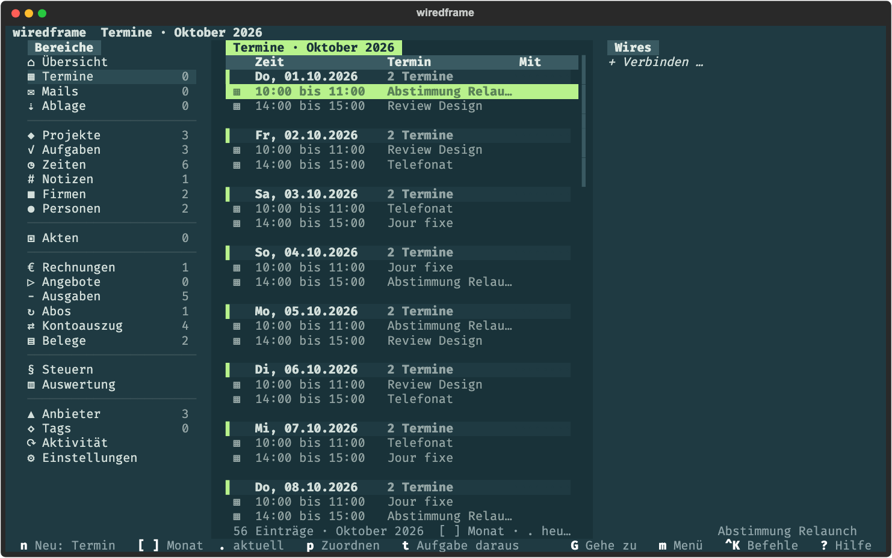

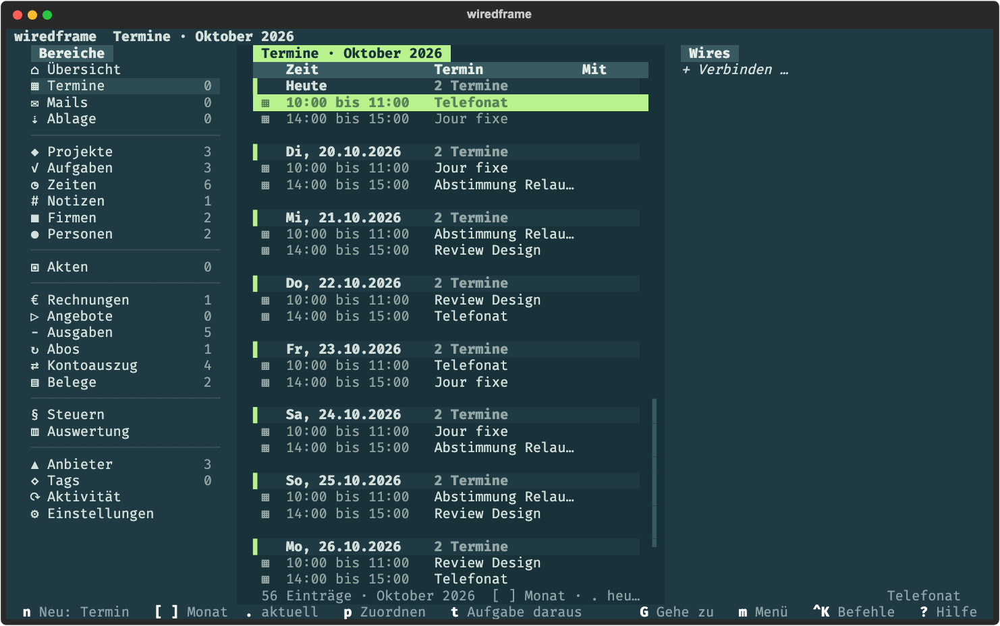

**Gemischt markierte Mails.** Waren mehrere Mails markiert und manche davon schon gelesen, sagte `x` nur: „Passt nicht auf alle markierten Einträge.“ Jetzt markiert `x` einfach alle als gelesen, wie in jedem Mailprogramm; `f` markiert alle.

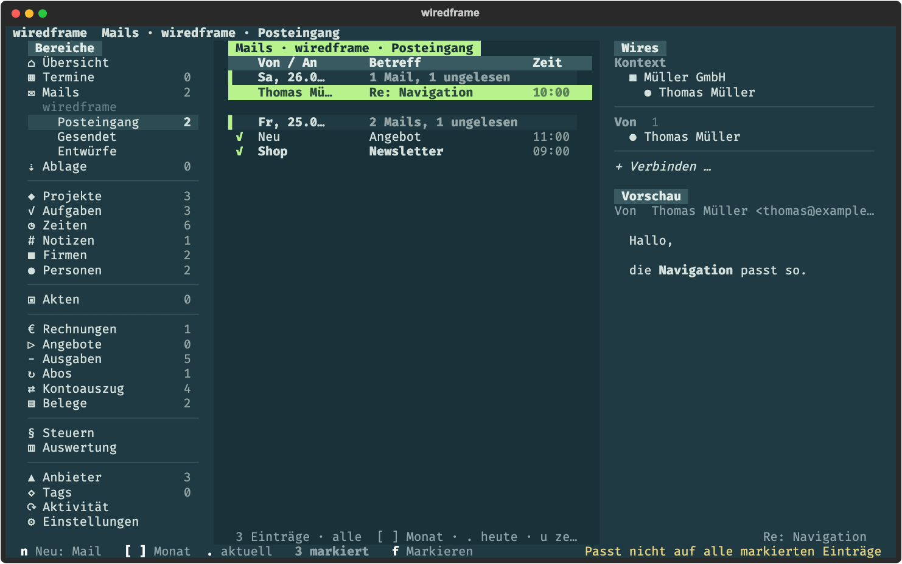

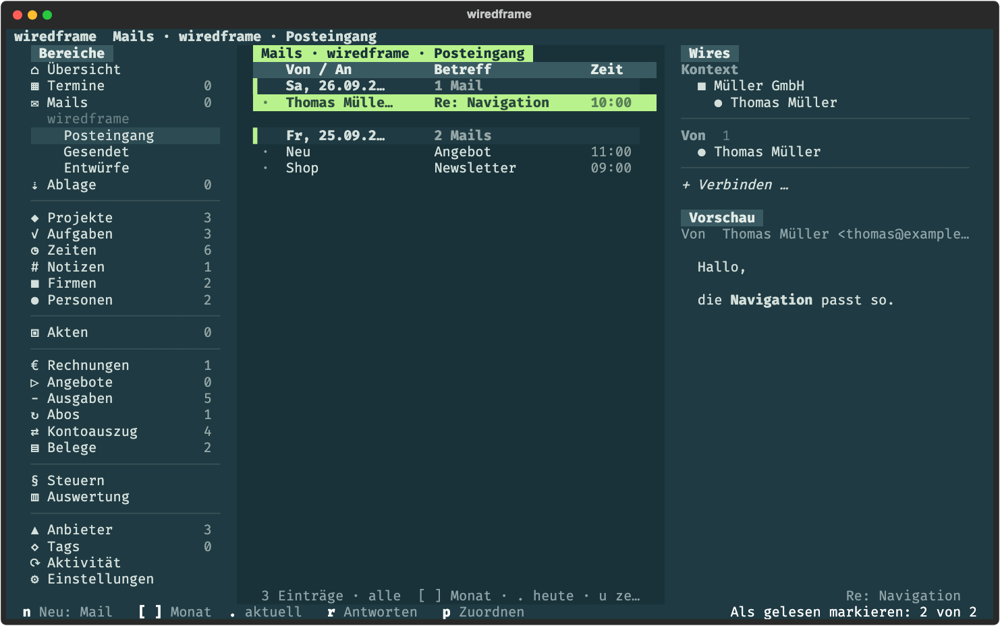

**Der vergessene Timer.** Lief der Timer seit gestern, sagte `S` nur, ich solle „Timer beenden um …“ benutzen. Den Befehl musste ich dann erst suchen. Jetzt öffnet `S` das Formular direkt mit einem vorgeschlagenen Ende. Kurz nach Mitternacht ist das die aktuelle Uhrzeit statt einer Zeit in der Zukunft. Und „90“ wird nicht mehr still als 90 Stunden interpretiert.

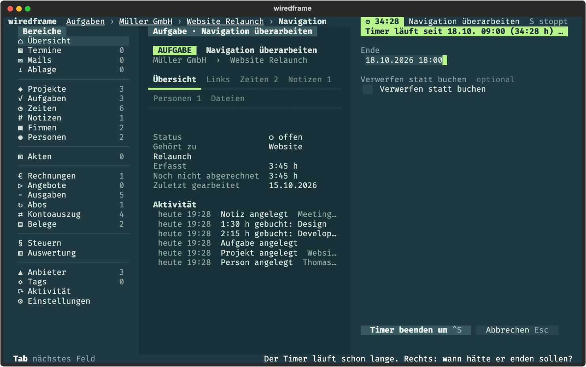

**Letzter Kontakt, lesbar.** „Vor 420 Tagen“ musste ich jedes Mal umrechnen. Jetzt steht dort „vor 14 Monaten“. Wichtiger war, was wir darunter fanden: Viele Termine waren keiner Person zugeordnet, weil der Kalender Teilnehmende mal nur als Mailadresse, mal als „Nachname, Vorname“ liefert. Außerdem fehlten nachträglich angelegten Personen die eigenen gesendeten Mails. Beides ist behoben; damit stimmt auch die Spalte.

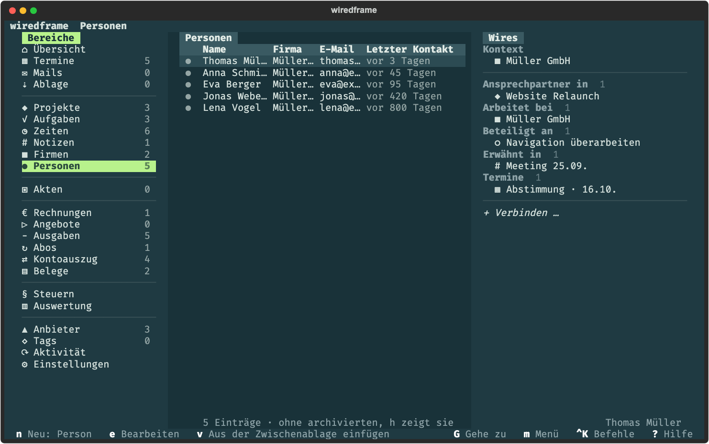

**Positionen im schmalen Fenster.** Ausgerechnet der Betrag rutschte rechts aus dem Bild, während links eine leere Spalte „Ticket / Datum“ stand. Bei Platzmangel weichen jetzt zuerst Umsatzsteuer und Einzelpreis. Menge und Betrag bleiben sichtbar.

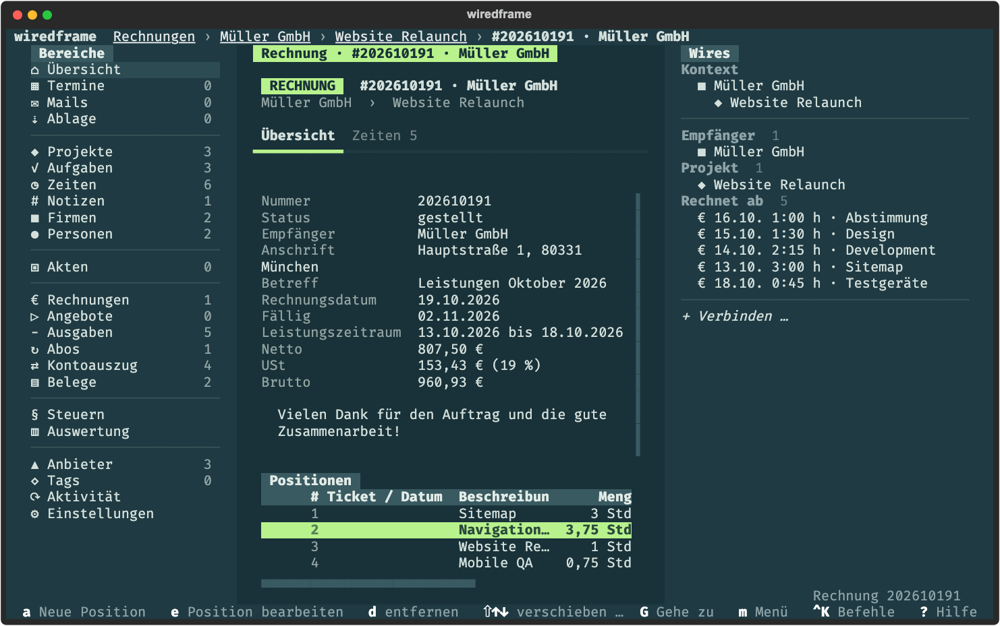

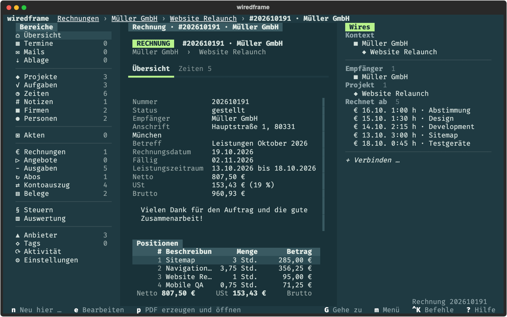

**Ein fehlender Ordner wird nicht mehr still ersetzt.** Benannte ich den Ordner einer Akte im Finder um, legte wiredframe beim nächsten Ablegen am alten Ort einfach einen leeren Ordner an. Meine Dateien lagen dann an zwei Stellen. Jetzt zeigt der Tab „Dateien“, welcher Ordner fehlt.

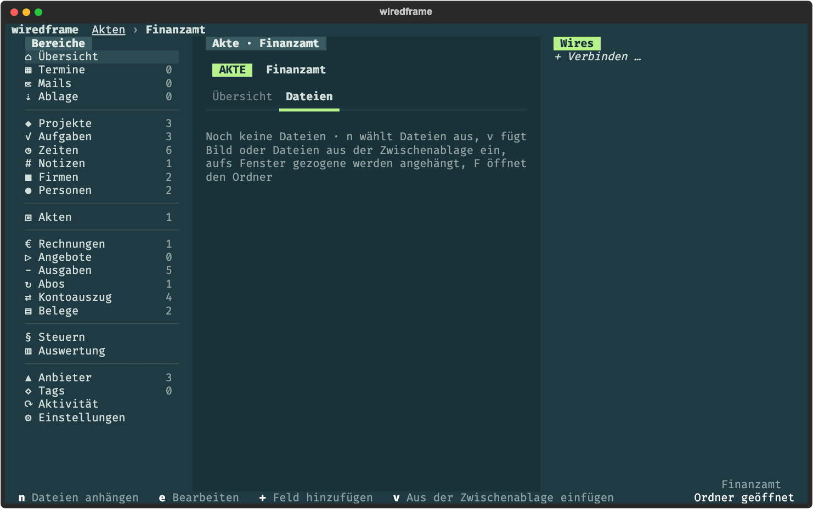

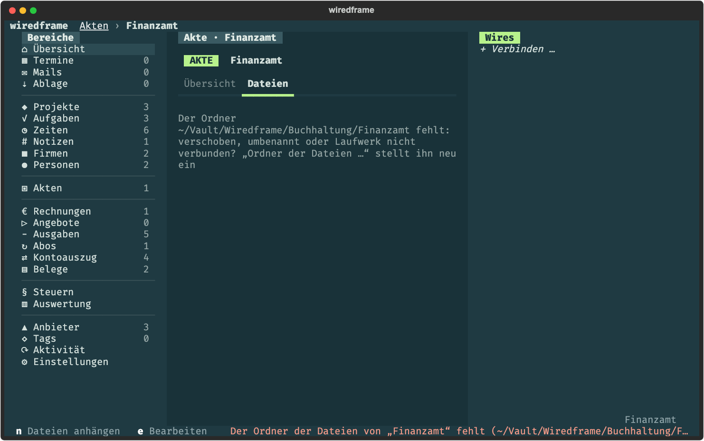

**Kleine Fenster.** Die Summenzeile unter einer Liste wurde abgeschnitten; bei Ausgaben stand „Vorsteuer“ ohne Betrag. Jetzt bricht sie um. Unter einer einzelnen Zeile steht „1 Eintrag“.

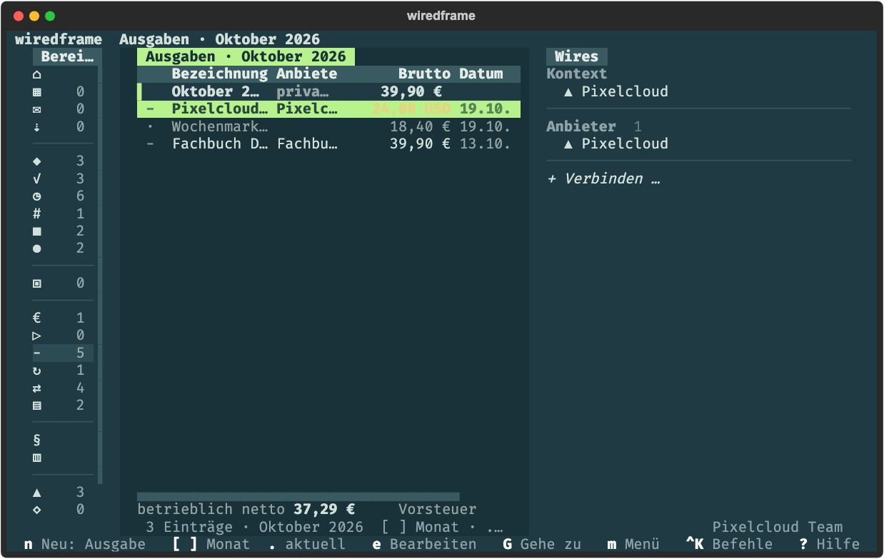

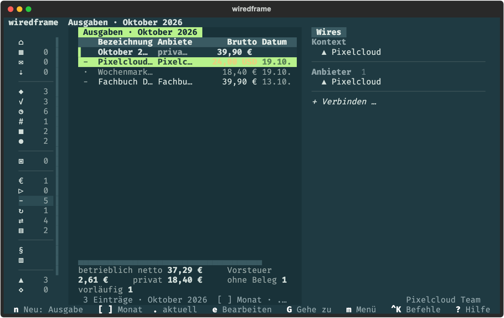

Vieles davon sieht man nicht. Ein Beleg landete still in der offenen Ausgabe vom Vorjahr, nur weil das Monatsabo gleich viel kostet. Zwei Überweisungen am selben Tag, gleicher Betrag, Bankreferenz „NOTPROVIDED“, wurden zu einer zusammengezogen. Absender mit Komma im Namen (etwa „Baumgartl, Bernhard“) zerfielen beim Abruf; 56 Mails hingen deshalb an niemandem. `wf restore` hätte mit der falschen Datei alle Daten durch eine leere Datenbank ersetzt. Und einen großen Kunden zu öffnen geht jetzt etwa doppelt so schnell, der erste Buchstabe in der Suche rund viermal: wiredframe merkt sich die Zusammenhänge bis zur nächsten Änderung.

Am meisten gelernt habe ich aber aus dem, was die Agenten nicht ändern durften. In meinen echten Daten steht eine Umsatzsteuer-Vorauszahlung über 500 Euro, zu der keine Abbuchung gehört. Im Ordner der Ausgangsrechnungen lagen drei PDFs von Rechnungen, die ich gestellt und gleich wieder gelöscht hatte. Solche Funde entscheide ich selbst.
