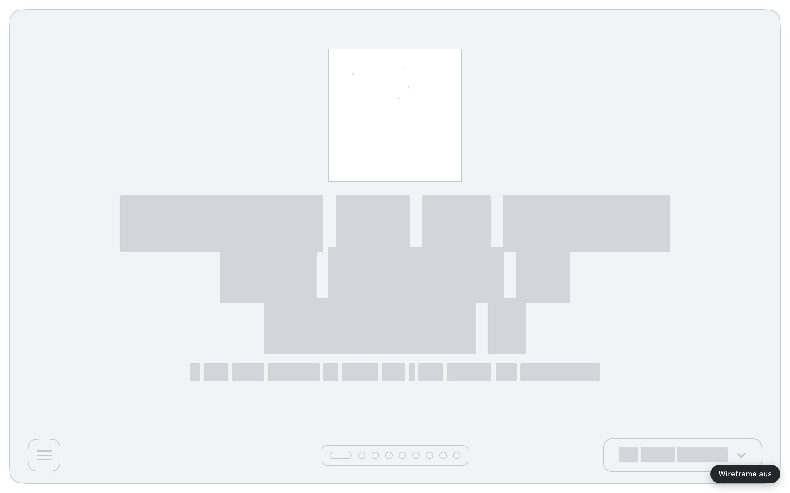
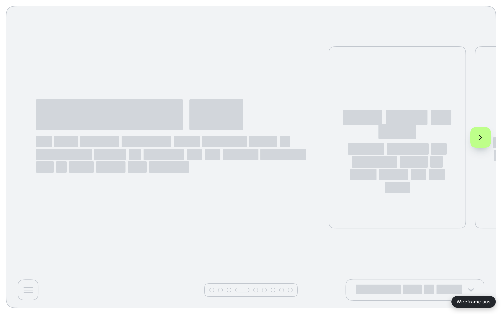

# Wireframe-Modus: Jede Seite als Graustufen-Skizze

*Ein kleines Skript für die Browserkonsole oder als Lesezeichen, das Farbe, Bilder und Text von einer Seite nimmt und nur das Gerüst übrig lässt.*


*Vorher: die Startseite dieser Website, wie man sie kennt.*



*Nachher: dieselbe Seite im Wireframe-Modus. Unten rechts die Pille zum Ausschalten.*

Wenn ich eine Seite beurteile, meine eigene oder einen Entwurf im Projekt, sehe ich zuerst Farbe, Bilder und Wörter. Das ist normal, aber es verstellt den Blick auf das, was darunter liegt: Wie ist die Seite gegliedert? Was ist wichtig, was ist Beiwerk? Stimmen die Abstände, hält das Raster? Eine starke Farbe oder ein schönes Foto kann eine schwache Struktur erstaunlich lange verdecken.

In Figma ist das einfach, da fange ich ohnehin mit grauen Kästen an. Bei einer fertigen Seite im Browser geht das nicht. Dafür gibt es den Wireframe-Modus: ein einzelnes JavaScript, das jede geladene Seite in eine flächige Graustufen-Skizze verwandelt, ohne das Layout anzufassen.

## Was dabei passiert

Das Skript macht aus einer Seite im Grunde vier Dinge:

- **Text wird zu Balken.** Jedes Wort bekommt einen hellgrauen Balken in seiner eigenen Breite und Höhe. Man sieht sofort, wo eine Überschrift sitzt, wie lang ein Absatz ist und wie viel Gewicht ein Knopf hat, ohne ein Wort zu lesen.
- **Bilder und Videos werden zu Platzhaltern.** Eine graue Fläche mit Diagonalkreuz, wie man sie aus Skizzen kennt. Kleine Grafiken unter 40 Pixeln werden zu schlichten Blöcken ohne Kreuz, sonst würde jedes Symbol zur Kreuzschraffur.
- **Farbflächen werden zu hellgrauen Blöcken mit Rahmen.** Karten, Kästen und Bänder bleiben als Form erhalten, verlieren aber ihre Farbe.
- **Schatten, Verläufe, Filter und Animationen fallen weg.** Was übrig bleibt, ist Fläche und Linie.

Ausgeschaltet wird mit Escape, mit einem zweiten Aufruf oder mit einem Klick auf die dunkle Pille unten rechts. Danach steht die Seite wieder genau so da wie vorher.


*Ein Abschnitt weiter: Überschrift, Absatz und die erste Karte einer Reihe.*



*Als Wireframe wird die Hierarchie deutlich: großer Titel, ein Absatz, rechts die Karte mit ihrem eigenen kleinen Gefüge.*

An diesem Paar sieht man gut, wofür ich das Werkzeug haben will. Ohne Farbe fällt auf, wie viel Luft die linke Spalte hat und wie viel höher die Karte ist als der Textblock daneben. Man sieht auch, was das Skript nicht perfekt macht: Das Strichsymbol in der Karte verschwindet ganz, und der Pfeil am rechten Rand behält seine Farbe. Für eine Strukturprüfung stört mich das nicht, es ist aber kein fertiges Produkt.

## Wie es funktioniert

Der Trick bei Text ist, ihn nicht zu ersetzen, sondern unsichtbar zu machen und zu hinterlegen. Das Skript läuft durch alle Textknoten, teilt sie an Leerzeichen auf und packt jedes Wort in ein eigenes `span`:

```
const parts = CFG.wordGaps ? n.nodeValue.split(/(\s+)/) : [n.nodeValue];
for (const part of parts) {
  if (!part) continue;
  if (/^\s+$/.test(part)) { frag.appendChild(document.createTextNode(part)); continue; }
  const s = document.createElement('span');
  s.className = 'wf-t';
  s.textContent = part;
  frag.appendChild(s);
}
```

Ein Stylesheet macht die Schrift dann transparent und gibt jedem `wf-t` eine graue Hintergrundfarbe. Weil der Text noch da ist, bricht er genau so um wie vorher. Die Balken haben also die echte Breite der Wörter, nicht eine geschätzte.

Bei Bildern ist es ähnlich. Statt sie zu entfernen, bekommt jedes Bild als Quelle ein leeres, transparentes SVG in seiner aktuellen Darstellungsgröße. So behält die Bildbox Größe und Seitenverhältnis, und nichts rutscht nach. Was sich nicht umfärben lässt, also `canvas`, `iframe` oder eingebettete Objekte, wird versteckt und von einer Platzhalterfläche in einer eigenen Ebene überdeckt.

Zwei Details machen das Skript robust auf fremden Seiten. Viele Seiten setzen ihre Farben mit `!important`. Damit das Wireframe trotzdem gewinnt, hängt das Skript an jede Regel ein dreifaches `:not(#_wf)`, das die Spezifität anhebt, ohne etwas auszuwählen. Und weil moderne Seiten ständig Inhalte nachladen, beobachtet es die Seite mit einem `MutationObserver` und behandelt neue Elemente gleich mit. Auch Komponenten in einem Shadow DOM werden erfasst.

Alles, was das Skript ändert, merkt es sich: Klassen, ausgetauschte Bildquellen, versteckte Elemente, die Wort-Spans. Beim Ausschalten wird genau das zurückgedreht.

Ein paar Stellschrauben stehen ganz oben im Code: die fünf Grautöne, ob es einen Balken pro Wort oder pro Zeile gibt, ob Bilder ein Kreuz bekommen und ob SVG-Grafiken zu Blöcken werden statt zu grauen Silhouetten.

## Zwei Wege in den Browser

Das Skript liegt in zwei Fassungen vor. `wireframe.js` ist der lesbare Quelltext, rund 500 Zeilen. Man fügt ihn in die DevTools-Konsole ein und führt ihn aus. Daneben liegt dieselbe Datei als Bookmarklet, also als URL-kodierte `javascript:`-Adresse von gut 30 Kilobyte. Als Lesezeichen in der Leiste abgelegt, reicht dann ein Klick, auf jeder Seite.

Für die Bilder in diesem Beitrag hat Claude das Skript per Headless Chrome in eine lokale Kopie dieser Website geladen und je Abschnitt einen Screenshot davor und danach gemacht. Ich zeige hier bewusst nur meine eigene Seite. Auf jeder anderen funktioniert es genauso, aber deren Gerüst ist nicht meins zum Vorführen.
