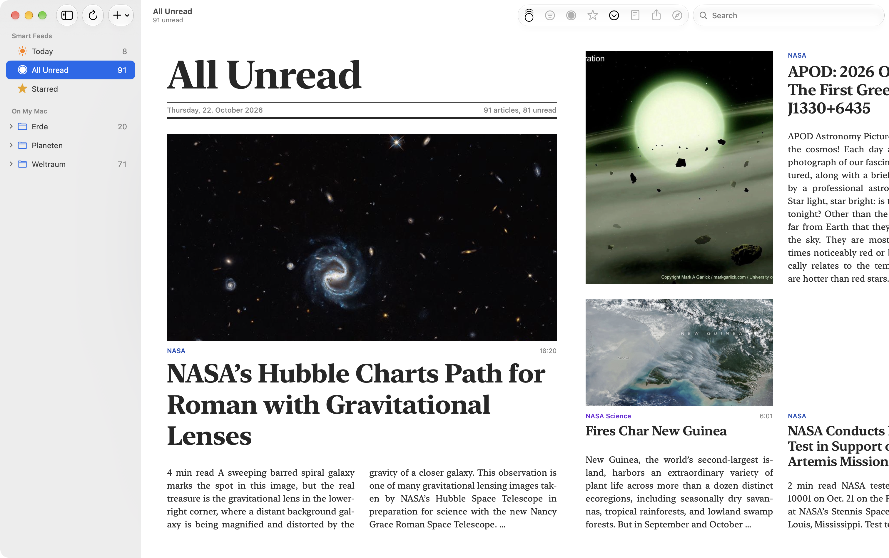
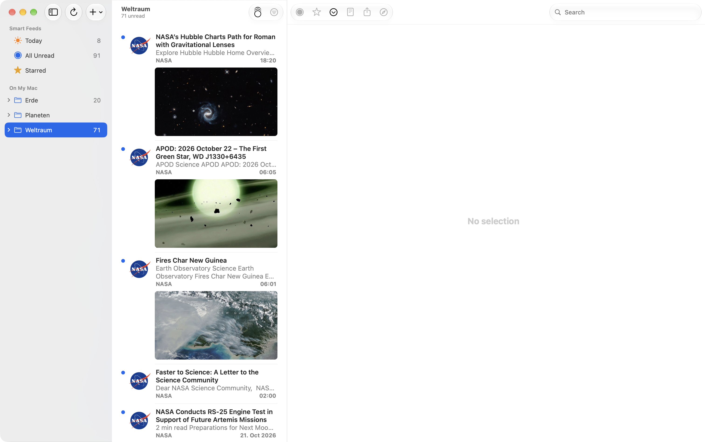
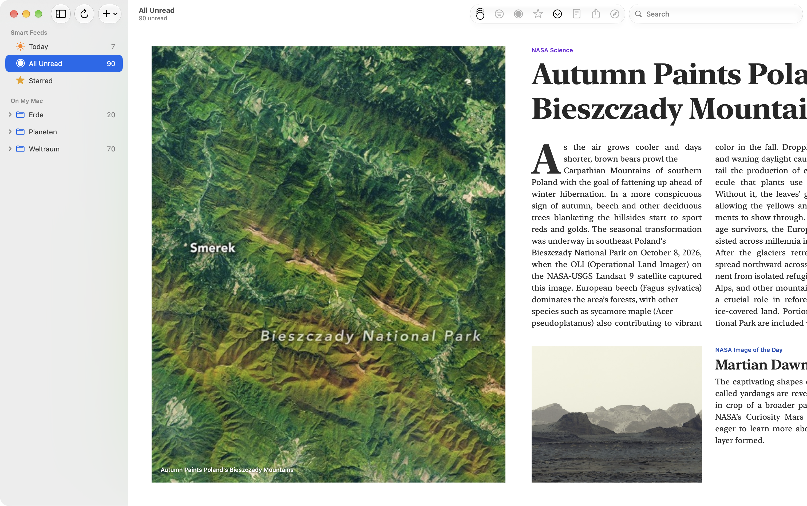
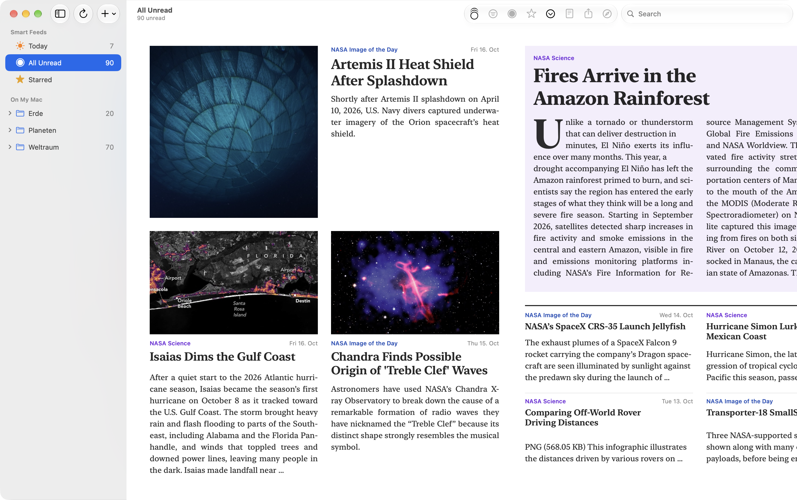
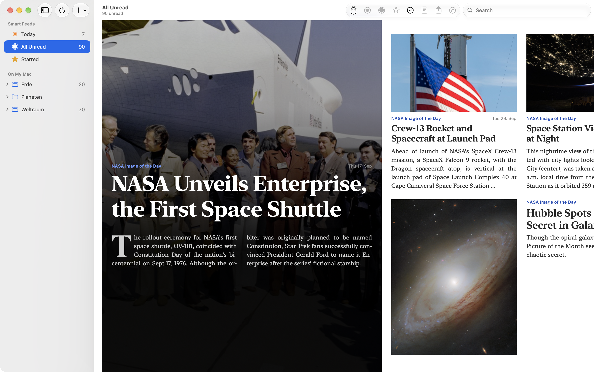
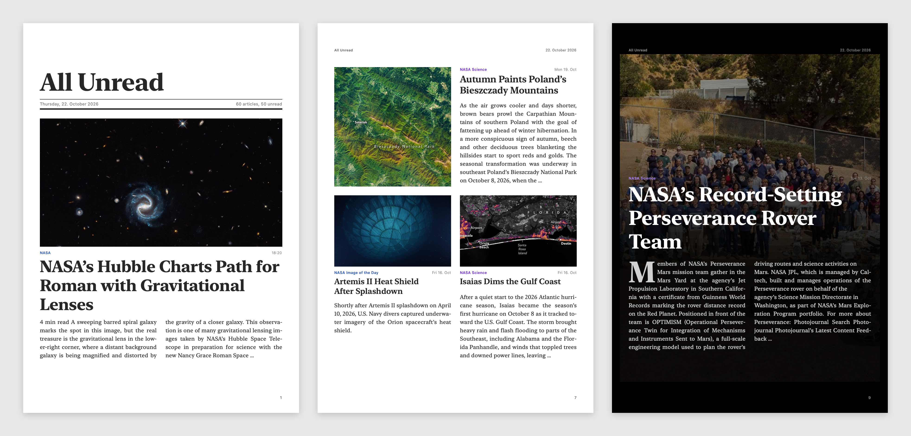

# RSS Feed Magazine: Mein NetNewsWire-Fork liest sich jetzt wie ein Magazin

*Seit 2020 wünschen sich Nutzer von NetNewsWire Bilder in der Artikelliste. Ich habe an einem Nachmittag einen eigenen Fork gebaut, und am Ende war daraus ein Magazin geworden.*

*Die Titelseite der Magazinansicht. Alle Bilder in diesem Beitrag zeigen gemeinfreie NASA-Feeds.*

NetNewsWire ist ein wunderbarer RSS-Reader: schnell, aufgeräumt, Open Source. Nur eines nervt mich seit Jahren. Die Artikelliste ist eine Textwüste. Links ein Feed-Logo, daneben Titel, zwei Zeilen Teaser, Uhrzeit. Dabei hat fast jeder Artikel ein Bild, und die Bilder erzählen oft mehr als der Teaser.

Ich bin nicht der Einzige, den das stört. Das Ticket „Feature request: image thumbnail on article list instead of feed icon“ ist vom Januar 2020. Im Juli 2026 schrieb Brent Simmons dort, er wolle so ein zentrales Feature wohl selbst bauen, wegen der Folgen für Bedienung, Speicher und Leistung. Das verstehe ich. Warten wollte ich trotzdem nicht.

Also habe ich mit Claude einen Fork gebaut. Er heißt RSS Feed Magazine, hat ein eigenes Icon und läuft neben der offiziellen App. Einen Pull Request gibt es bewusst nicht: Die Regeln des Projekts verlangen vorher Abstimmung, und das Feature ist erklärtermaßen Chefsache.

## Bilder, wo sie hingehören

Der erste Schritt war der, um den es im Ticket geht. Jeder Eintrag in der Liste bekommt unter Titel und Uhrzeit sein Bild, fest im Format 16:9, bündig mit dem Text. Die Zeilenhöhe steht fest, bevor das Bild geladen ist, so springt beim Scrollen nichts.

*Jeder Eintrag mit seinem Bild. Feine Trennlinien wie in Mail zeigen, welche Überschrift zu welchem Bild gehört.*

Zwei Details kamen erst durchs Benutzen dazu. Mit Bildern war nicht mehr klar, welche Überschrift zu welchem Bild gehört. Seitdem trennen haarfeine Linien wie in Mail die Einträge, die an der Auswahl aussetzen, damit sie deren runde Ecken nicht berühren. Und die Bilder werden verkleinert auf 960 Pixel und landen in einem Cache mit fester Obergrenze. Wer täglich Hunderte Artikel bekommt, will keinen Ordner, der still auf Gigabytes wächst.

## Vom Prototyp zum Magazin

Dann kam mir eine Idee, die mit dem Ticket nichts mehr zu tun hat: Warum überhaupt eine Liste? Warum nicht eine einzige Fläche, die sich liest wie ein gedrucktes Magazin, mit festem Raster, großen Überschriften und Textspalten?

Claude hat zuerst einen Prototyp in HTML gebaut, mit meinen echten Artikeln, als Doppelseiten mit Seitenzahlen. Das sah erstaunlich gut aus, war mir aber zu sehr Buch. Was blieb, war die Idee: eine weiße Fläche, die sich horizontal durchblättern lässt, gebaut nativ mit SwiftUI.

*Links das Bild randlos, rechts dieselbe Geschichte mit großer Überschrift.*

Die Artikel landen auf einer Handvoll Vorlagen, die sich abwechseln: Titelseite, Zeitungsseite, Bildseite, schwarze Seite, Kurzmeldungen. Für jeden Platz sucht die App unter den nächsten Artikeln den passendsten. Artikel mit Bild kommen auf die Bildplätze, solche mit viel Text in den Leitartikel, kurze ohne Bild in die Kurzmeldungen. Dieselbe Meldung aus zwei Feeds eines Verlags erscheint nur einmal.

Jeder Ordner ist ein Ressort mit eigener Farbe. Die Farbe wandert mit dem Artikel: In „All Unread“ sieht man beim Blättern an der Dachzeile, wann das Thema wechselt, wie in einer Zeitung.

## Was Printdesigner wissen

Den Fließtext setzt TextKit, weil SwiftUI keinen Text über mehrere Spalten laufen lassen kann. Blocksatz, Silbentrennung, Initialen über drei Zeilen. Hier hat mich mein Designerauge viele Runden gekostet, und das ist gut so.

*Eine Zeitungsseite. Ein Leitartikel ohne Bild trägt eine zarte Fläche in der Ressortfarbe.*

Die Initiale saß zu tief, weil ihre Größe geschätzt war. Inzwischen misst die App, wo TextKit die erste Grundlinie setzt, und rechnet die Schriftgröße so, dass der Buchstabe genau von der Versalhöhe der ersten bis zur Grundlinie der dritten Zeile reicht. Im Blocksatz standen manchmal gesperrte Buchstaben, „S c h & u u m l ; t z e n“. Die Ursache war ein Südtiroler Feed, der seine Umlaute als HTML-Entities schickt; die kann TextKit nicht trennen. Meine erste Wahl für die Überschriften war Didot, auf großen Größen viel zu weit gesperrt. Geworden ist es New York, die Serifenschrift von macOS.

Irgendwann habe ich Claude gebeten, in der Branche nachzulesen statt zu raten. Die Recherche in Bringhurst, Müller-Brockmann und Harrowers Zeitungshandbuch brachte klare Regeln: Blocksatz erst ab etwa 40 Zeichen pro Zeile, darunter Flattersatz. Text aller Spalten auf einem gemeinsamen Grundlinienraster. Feste Größenstufen für Überschriften nach Rang und Breite, und eine lange Überschrift rutscht lieber eine Stufe kleiner, als auf fünf Zeilen zu laufen. Dieselbe Vorlage nie zweimal hintereinander.

Das Grundlinienraster hat erst einmal alles kaputt gemacht. Text stand doppelt und versetzt übereinander. Claude hatte den Versatz beim Zeichnen aus der Position im Fenster berechnet, und macOS zeichnet in Kacheln. Verschob SwiftUI die Ansicht zwischen zwei Kacheln, passten sie nicht mehr zusammen. Die Lösung: SwiftUI misst die Lage jeder Textspalte im Block und gibt den Versatz fest weiter.

*Die schwarze Seite: Das Bild liegt über der ganzen Seite und läuft zum Text hin in Schwarz aus.*

## Die versteckten Bilder

Ausgerechnet Merkur, BR24, t3n und Notebookcheck zeigten keine Bilder, und GameStar nur Pixelbrei. Der Grund war überraschend: Diese Feeds haben ihr Bild gar nicht im Artikeltext, sondern in eigenen Feldern, in `media:content`, als Anhang oder, bei BR24, in einem ARD-eigenen Format. NetNewsWire hat diese Felder nie gelesen. Das tut der Parser in RSS Feed Magazine jetzt.

Bei GameStar steckte im Text ein Teaserbild mit 127 Pixeln Breite, und im Feld daneben dasselbe Bild mit 1.920 Pixeln. Von mehreren Bildern nimmt er jeweils das größte. Damit das auch für Artikel gilt, die schon in der Datenbank lagen, liest die App beim ersten Start einmal alle Feeds neu. Neue Tests sichern das ab, alle 333 Tests des Parsers laufen grün.

## Und auf Papier

Weil die Magazinansicht ohnehin aus seitenähnlichen Blöcken besteht, war der Schritt zum PDF klein. „Export Magazine as PDF“ macht aus jedem Block eine A4-Seite, mit Seitenkopf, Seitenzahl und einem Link auf jedem Artikel. Text bleibt Text, durchsuchbar und gestochen scharf.

*Aus dem PDF: Titelseite, Bildseite, schwarze Seite.*

Der knifflige Teil war unsichtbar. SwiftUIs PDF-Renderer zeichnet alles außer den TextKit-Spalten, AppKits PDF-Export nur die Spalten. RSS Feed Magazine rendert deshalb jede Seite zweimal und legt die Spalten an ihren gemessenen Positionen über das Bild. Einen Farbverlauf zeichnet der Renderer im PDF übrigens als schwarze Fläche; auf der schwarzen Seite verlief das Bild deshalb zuerst ins Nichts. Stattdessen sind es nun 48 feine Streifen, die auf Papier genauso aussehen.

## Ein Nachmittag

Der erste Commit kam um zwölf Uhr mittags, der letzte für diesen Beitrag gegen sieben Uhr abends. Dazwischen liegen gut 3.700 neue Zeilen, ein HTML-Prototyp, der jetzt in der Schublade liegt und vielleicht einmal ein PDF-Generator wird, und eine Abo-Liste, die von 36 auf 84 Feeds gewachsen ist. Ich habe sie gleich mit Claude erweitert: Design, Webentwicklung, Mac, Xbox und Nintendo, jeweils vorher getestet, ob der Feed lebt und ordentliche Bilder hat.

Ich lese meine Feeds jetzt anders. Nicht mehr als Liste, die abgearbeitet werden will, sondern wie eine Zeitung, durch die man morgens blättert.

RSS Feed Magazine ist Open Source wie das Original: Code, Screenshots und Release liegen auf [GitHub](https://github.com/Wiredframe/rss-feed-magazine), installieren lässt es sich mit `brew install --cask wiredframe/tap/rss-feed-magazine`.
