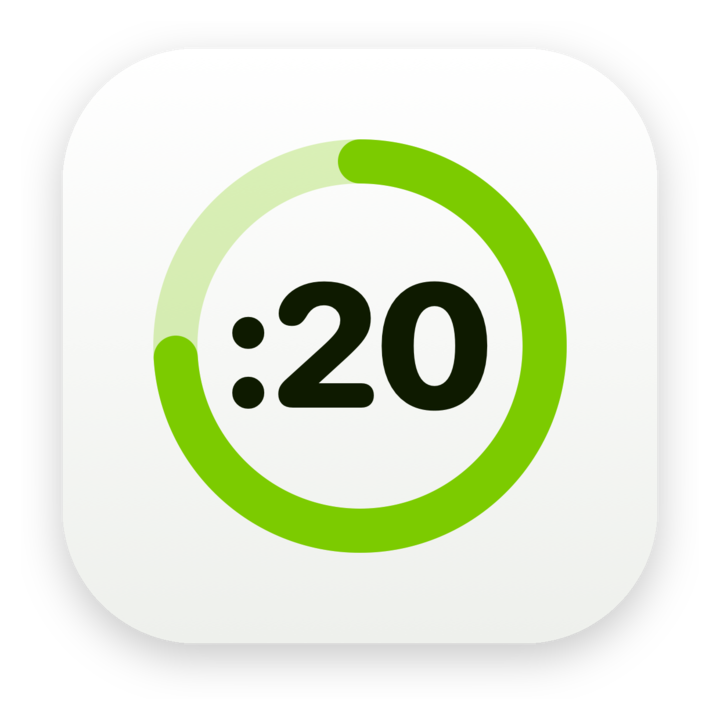
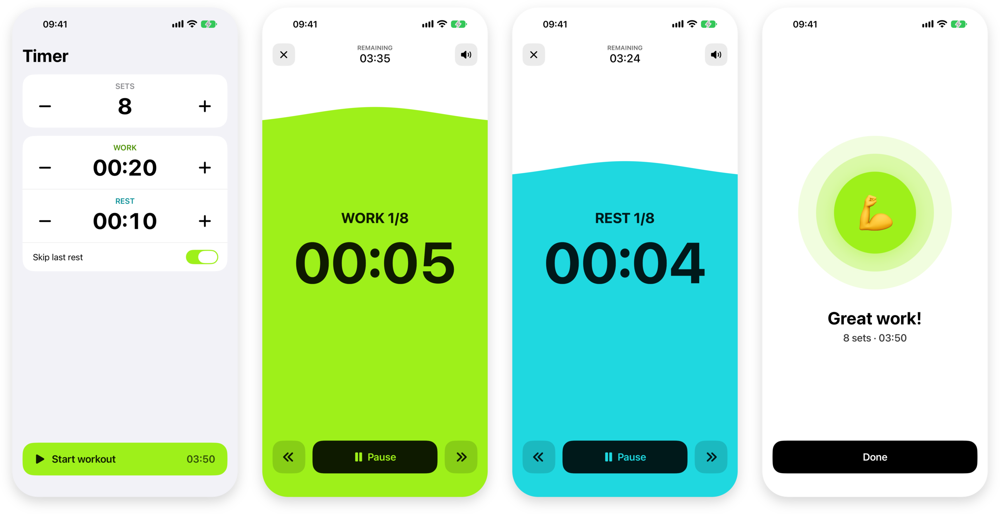
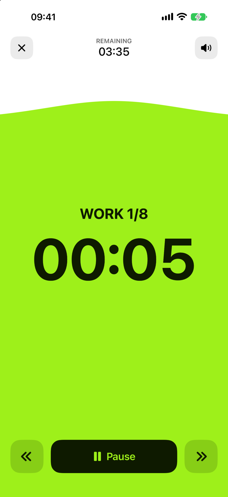

# Plain Tabata Timer: Ein Timer, der nur eins kann

*Ich wollte einen Intervall-Timer, der schön ist, einfach bleibt und mir nie etwas verkaufen will. Also habe ich ihn gebaut. Bald gibt es ihn kostenlos im App Store, ohne Werbung, ohne Abo, ohne Pro-Version.*

Für Tabata und HIIT brauche ich drei Zahlen: wie viele Runden, wie lange Arbeit, wie lange Pause. Dann einen Knopf zum Starten. Mehr nicht.

Im App Store gibt es dafür Tausende Apps. Fast alle wollen mehr von mir als diese drei Zahlen. Ein Konto, damit meine Workouts „in der Cloud“ liegen. Eine Pro-Version für Dinge, die eigentlich dazugehören. Ein Abo im zweiten Monat. Banner zwischen zwei Sätzen Burpees. Und wer eine App länger benutzt, kennt den Verlauf: Mit jedem Update wird sie ein bisschen voller, ein bisschen lauter, ein bisschen weniger meins. Dafür gibt es inzwischen ein Wort, Enshittification.

Ich wollte das Gegenteil. Eine App, die heute fertig ist und in zwei Jahren nicht schlechter. Gebaut habe ich sie mit Claude an einem einzigen Tag, dem 1. November. Claude schrieb den Code, ich entschied, was hineinkommt und vor allem, was nicht.

## Was ich weggelassen habe

Die Liste ist länger als die Liste der Funktionen, und darauf bin ich ein bisschen stolz:

- keine Workouts mit mehreren Übungen, keine Workout-Bibliothek
- kein Verlauf, keine Statistik, keine Serien, keine Abzeichen
- keine Bewertung, keine Notiz, kein Lesezeichen am Ende
- kein Konto, keine Cloud, keine Netzwerkverbindung
- keine Werbung, keine In-App-Käufe, kein Abo
- kein Schalter für Hell und Dunkel; die App folgt einfach dem iPhone

Den Schalter für Hell und Dunkel gab es übrigens zuerst. Er hat nicht richtig funktioniert, und als wir ihn reparieren wollten, fiel mir auf, dass ihn niemand braucht. Das iPhone weiß schon, welchen Modus ich will. Also flog er raus.

Was bleibt, ist ein Bildschirm zum Einstellen: Sets, Arbeit, Pause, jeweils mit Plus und Minus in Fünf-Sekunden-Schritten, dazu ein Schalter „Letzte Pause überspringen“. Die App merkt sich die Werte. Wer jeden Morgen dasselbe trainiert, öffnet sie und drückt auf Start.

*Einstellen, arbeiten, ausruhen, fertig. Das ist die ganze App.*

## Eine Fläche statt Ringe

Viele Timer zeigen den Fortschritt als dünnen Ring um die Zahl. Beim Training liegt das iPhone aber zwei, drei Meter weg auf dem Boden, und ich bin außer Atem. Einen Ring sehe ich da nicht.

Deshalb füllt sich bei Plain Tabata Timer der ganze Bildschirm von unten, wie ein Glas. Ein Blick aus dem Augenwinkel reicht: halb voll, gleich vorbei. Die Kante ist ein sanfter Hügel, keine gerade Linie, damit es nach etwas Lebendigem aussieht und nicht nach einem Balkendiagramm.

Dahin hat es ein paar Umwege gebraucht. Zuerst gab es Wellen, die sich bewegten. Dann hat Claude eine Variante mit Sand gebaut, mit echter Physik: Körner, die fallen, rollen und sich auftürmen. Das war wirklich hübsch, und ich habe eine Weile damit gespielt. Am Ende habe ich es trotzdem verworfen. Beim Training will ich nicht zuschauen, wie Sand rieselt, ich will wissen, wie lange es noch dauert. Übrig blieb eine einzige ruhige Fläche.

*Wo die Fläche über Zeit und Knöpfe steigt, wechseln sie die Farbe und bleiben lesbar.*

## Zwei Farben, und nur dort, wo sie etwas sagen

Am Anfang war das Grün der App das übliche iOS-Grün. Das sah aus wie jede zweite Fitness-App. Ich wollte etwas Frischeres und bin bei einer Limette gelandet, `#9EF01A`, die fast leuchtet. Für die Pause kam ein Aqua dazu, `#1FD8E0`.

Die zweite Entscheidung war wichtiger: Die Farbe gehört nur der Fläche. Der Rest des Bildschirms bleibt neutral, weiß im hellen Modus, schwarz im dunklen. So bedeutet Farbe immer genau eins. Grün heißt arbeiten, Aqua heißt ausruhen. Das versteht man, ohne eine Zahl zu lesen.

Wo die Fläche Text oder Knöpfe überdeckt, liegt eine zweite, maskierte Ebene darüber, die dieselben Inhalte in dunkler Tinte zeigt. Die Ziffern wechseln also genau an der Kante ihre Farbe. Das ist ein Detail, das man nicht bemerkt, solange es funktioniert. Bis es funktionierte, hat es länger gedauert, als mir lieb war: Maske und Fläche müssen am exakt selben Rahmen hängen, sonst sieht man die Welle doppelt.

## Töne ohne eine einzige Audiodatei

Beim Training schaue ich meistens nicht aufs Display, ich höre zu. Es gibt deshalb vier Töne: ein kurzes Klicken bei 3, 2, 1, eine steigende Oktave zum Start, eine fallende Folge zur Pause und eine kleine Melodie zum Schluss.

Als ich Claude fragte, woher er die Töne habe, war die Antwort: von nirgendwo. Sie werden beim Start im Code erzeugt, als weiche Sinusklänge. Die App enthält keine einzige Audiodatei. Das hält sie klein, und es gibt keine Lizenzfrage.

Eine Sache war mir dabei wichtig: Meine Musik läuft weiter. Die Töne legen sich darüber, statt den Podcast anzuhalten. Das klingt selbstverständlich, war es aber erst nach einem eigenen Update.

## Genau, auch mit gesperrtem Bildschirm

Die Zeit zählt die App nicht selbst hoch, sie rechnet sie aus der Uhrzeit aus. Sperre ich das iPhone oder wechsle kurz in eine andere App, stimmt der Timer danach trotzdem auf die Sekunde. Während des Workouts bleibt der Bildschirm an, in der Pause darf er wieder ausgehen.

Vor dem ersten Set gibt es zehn Sekunden zum Bereitmachen. Die sind fest und lassen sich überspringen. Auch das ist eine Entscheidung: eine Einstellung weniger, über die man nachdenken muss.

## Klein bleiben

Die ganze App besteht aus rund 900 Zeilen Swift in sieben Dateien. Sie braucht iOS 27, damit wir keinen Ballast für alte Systeme mitschleppen. Sie sammelt keine Daten, und es gibt nichts, was man kaufen könnte.

Der Quellcode liegt offen auf [GitHub](https://github.com/Wiredframe/timer), wer mag, kann ihn sich ansehen oder die App selbst bauen. Im App Store erscheint sie in Kürze als Plain Tabata Timer, kostenlos und so, wie sie heute ist. Auf dem Homescreen heißt sie einfach Timer.

Das Versprechen dahinter ist schlicht: Sie wird nicht voller. Wenn ein Update kommt, dann weil etwas besser funktioniert, nicht weil etwas Neues verkauft werden soll.
